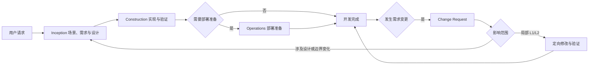

# AI-DLC 开发流程概览

**用途**：仅用于展示流程全貌，不定义规则。默认执行见 [宿主执行协议](host-execution.md)；只有显式选择旧受管流程时，阶段路由才使用 `core-workflow.md` 和对应 steering。

## 生命周期边界

AI-DLC 覆盖完整开发流程：需求与验收定义、I13 测试用例派生、RED 测试门禁、GREEN 实现、审查、实际构建测试，以及按需执行的部署准备。流程不覆盖部署后的生产运营。

## 受管阶段示意（非默认执行清单）

1. Inception：工作区检测 → 场景分析与模块映射 → 需求与交叉审查 → 用户故事与交叉审查 → 条件 UI 设计 → 条件 PRD 生成与审查 → 工作流规划 → 条件应用设计 → I13 测试用例派生 → 条件单元生成。
2. Construction：按单元设计 → I13 测试用例派生 → RED 测试门禁 → GREEN 实现 → 规格审查 → 质量审查 → 全局审查 → 实际构建和测试。
3. Operations（条件）：部署目标确认 → 目标相关配置 → 配置验证 → 部署/回滚说明。
4. Change Request：定位 → 影响评估 → 计划 → 逐层回写与实现 → 一致性验证。

局部 CR 在已有授权下连续完成上述适用动作；L1/L2 直接修改并验证受影响范围，不重新启动整套 Inception。跨边界、迁移或架构变化才按实际影响返回相关设计步骤。

## Mermaid 视图

## 自适应原则

复杂度决定实际分析和验证范围，既有质量与验收标准保留。默认宿主不引入受管阶段与签名证据要求；旧受管流程的快速通道、精简流程和步骤条件见 `common-complexity-assessment.md` 与 `core-workflow.md`。
