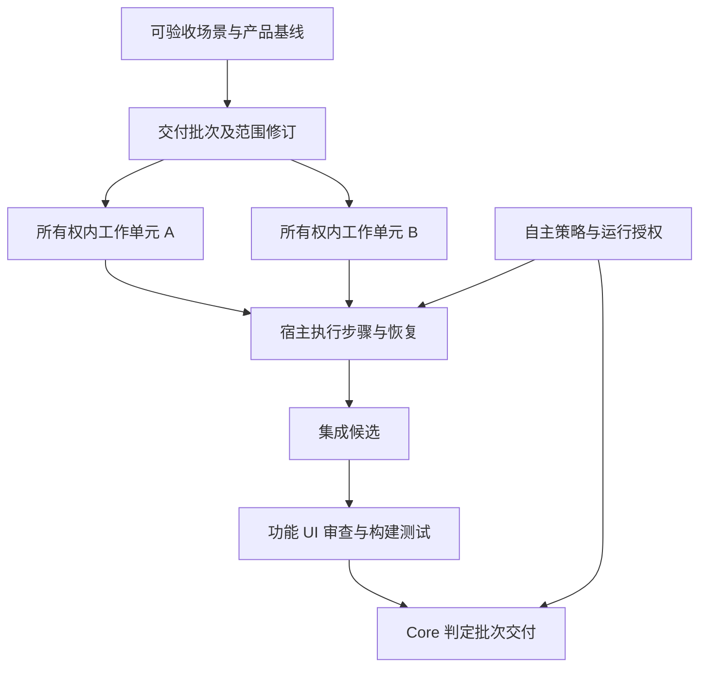
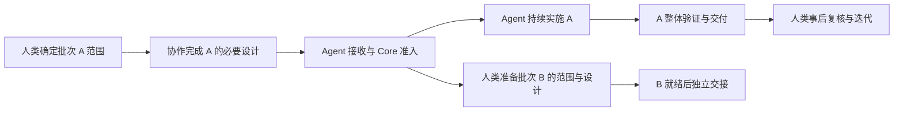
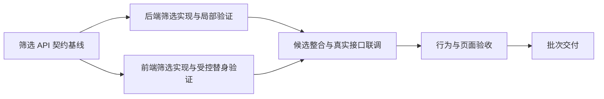

> Historical 4.x design/evaluation; not current execution instructions. See [current rules](../../../core/knowledge/protocols/host-execution.md).

# AI-DLC 自主实施与持续交付设计

| 项目 | 内容 |
| --- | --- |
| 文档状态 | P0 完成；P1 工程及续验修复已有分层证据，P1-10 真实交付仍未通过且 HOLD；P2 已启动，P2-01 持久检查点基础已工程实施，后继/自动恢复尚未启用；详见 P1/P2 实施记录 |
| 设计日期 | 2026-11-08（Asia/Shanghai） |
| 核对基线 | 当前仓库 package version 4.26.3；以文末列出的源码和协议为依据 |
| 工作范围 | 自主实施准入、单元与交付批次、决策委托、持久执行、中断恢复、功能与 UI 验收 |
| 当前产出 | 总体设计、P0 契约/演练及宿主探针；用户追加授权后实施 P1-01～09，进度、验证及退出见 P1 记录第 20/21 节；完整真实宿主双试点仍按 P1-10 执行 |

P0 实际结果见[契约 v1.0](aidlc-autonomous-contracts-v1.md)与[P0 执行记录](aidlc-autonomous-implementation-p0.md)。本设计不构成任何真实运行授权、阶段审批或通过证据。

G-03 已通过[实际模型与工具探针](evals/autonomy/g03-20261108-bc588ffc/README.md)条件化解除：正常本机外层环境中，Codex CLI 保留 workspace-write 沙箱完成三步命令和独立结果复核。P0 结论为 ready-for-p1-implementation。用户随后明确允许先编码 P1-01，见[P1 实施记录](aidlc-autonomous-implementation-p1.md)；业务运行准入、UI/试点验收与中断恢复未由此通过。

## 1. 目标与关键结论

人类在白天与 Agent 完成产品和设计基线，按可验收场景交接一个就绪批次。Agent 使用宿主已有的执行、上下文管理和恢复能力，自主完成设计细化、编码、审查、修复、集成及真实验证，交付可供人类验收的候选版本。人类事后复核委托决策，并通过增量迭代调整结果。

本设计采用以下决定：

1. Core 管理范围、准入、授权、依赖、领取、证据及完成判定；宿主管理模型循环、执行者、上下文、进程、并行和恢复调度。Core 不重建通用 Supervisor。
2. 人类交接位置以本批次必要功能设计完成为主，并要求上游产品、UI、架构和依赖事实闭合；不等待整个产品或业务模块设计完毕。
3. 实施中的普通技术选择与有限语义空白降为委托决策，Agent 按已授权兜底策略先实施、验证和记录，完成后供人类调整。大量未决产品问题应在准入前解决。
4. 降低即时人工介入，不降低功能完整性、UI 还原、真实测试、证据和权限要求。
5. 以场景组织交付批次，在服务和模块所有权边界内按内聚行为增量划分工作单元。批次聚合多个单元，不能反向改变服务边界。
6. 依赖落实到具体能力、消费阶段和所需状态；单元实现完成、批次集成通过和批次交付完成分别判定。
7. 用稳定 run 身份承载一次授权，用具体 session、attempt 和 generation 控制每次执行；原生会话恢复后仍须核对状态、代码、证据和外部环境。
8. 新模式显式采用。旧 workflow 不自动获得新授权，也不因升级静默增加准入或验收要求。

“持续交付”在本文中指持续产出已验证的集成候选及交付材料。写入受保护分支、push 和实际部署分别依项目授权执行，不因设计审批自动获得权限。

## 2. 当前基础与差距

| 当前能力 | 可复用部分 | 本设计补充 |
| --- | --- | --- |
| 阶段图与 execution_policy | 普通 notify 阶段复用授权，next/report 强制门禁 | 批次范围、准入检查点、运行终止条件及结构化原因 |
| 工作单元 | 独立认领、单元阶段、服务所有权、条件阶段、故事和 UC-D 归属 | 行为增量优先、批次映射、能力级依赖与修改责任 |
| 场景装配清单 | FR、模块、契约、页面及来源新鲜度索引 | 批次、单元、验收与集成责任引用 |
| 单元并行 | Unit Contexts、精确实例领取、独立证据路径 | 基于依赖和写入冲突的调度输入，场景闭合优先 |
| evidence_inputs | 私有、共享与传递依赖输入，定向失效 | 自主并行批次的完整声明要求；与写入范围分开 |
| session claim | owner/session/generation、expected token、受控发布锁 | run 授权内的后继会话恢复，保留原有隔离保护 |
| TDD、审查与 C8 | I13、RED/BASELINE/GREEN、双轴审查、真实构建测试 | 批次范围门禁与最终候选的行为和 UI 运行时验证 |
| UI alignment | 页面映射、标记、部分元素计数与粗粒度样式检查 | 实际渲染、区域级视觉检查、交互及业务链路证据 |
| 事后抽审 | notify 产物与后续问题追踪 | 委托决策的汇总、复核和增量修订 |

当前单元规则建议后端按业务模块、前端按页面模块拆分，可能使一个可验收功能横跨过大的前后端单元。当前 C8 为 project 轴，聚合计划内单元；若一个长 workflow 不断增加功能，仅有该屏障会延迟已就绪功能的交付。

当前宿主执行边界已将模型和委派交给宿主，旧 Agent runtime 已退役。宿主支持会话执行或恢复，不等于所有安装配置都能自动重启进程，或恢复浏览器、Shell、数据库和外部任务。接入时按具体版本、入口与配置核验能力，不按产品名称推定。

## 3. 领域模型与权威边界

### 3.1 对象关系

| 对象 | 职责 | 不承担的职责 |
| --- | --- | --- |
| 服务/模块 | 部署、数据或逻辑所有权边界，沿用当前定义 | 不因并行需求创建新服务 |
| 场景 | 用户起点、终点、业务规则及验收语义 | 不复制模块需求和页面规格 |
| 交付批次 batch | 本次场景范围、必要单元、依赖闭包、候选和交付验收 | 不成为独立业务基线或新工作流引擎 |
| 工作单元 unit | 有限修改范围、具体实现、局部验证与领取 | 不代替跨单元集成验收 |
| 宿主步骤 task | 实施拆解、执行分配、局部检查点 | 不自行增加 Core 阶段或完成状态 |
| run | 在一个批次范围修订内执行的一次授权运行，可包含多个 attempt | 不覆盖或替代 workflow state |
| session/attempt | 实际执行会话和一次尝试 | 不因保存对话自动获得 claim |

一个批次可以覆盖多个服务和模块，但每个 unit 仍归属唯一模块，并保持既定服务所有权。跨模块引用使用包含 module_id 的完整 UnitRef，避免同名 unit 冲突。

### 3.2 单一权威来源

- 需求、故事、UI、应用设计与契约继续在现有 canonical 产物中维护。
- 场景、批次与单元之间保存 ID 和来源引用，不复制完整业务内容。
- 依赖在 unit-of-work-dependency.md 中保存结构化权威段；机器投影只读生成，不能独立编辑。
- 批次定义扩展现有 scenario-module-mapping.md 的结构化段；它是范围定义，不保存运行进度。
- 自主策略保存在既有 development-handoff.md 的结构化段；阶段未使用该产物的轻量范围引用既有 handoff.md。不得同时维护两份。
- 委托决策保存在现有 handoff.md 的结构化段，详细设计就地同步并引用 decision_id。汇总是派生视图。
- workflow state、audit 和 ledger 仍由 Core 写入。批次生命周期作为其受管扩展，不产生独立可编辑的 batch-state 文件。
- 授权、准入凭据和验证证据由受控入口发布；宿主检查点只保存执行事实和权威记录引用。

## 4. 人类交接位置与完成程度

### 4.1 标准功能流程

本批次的人类参与覆盖需求与澄清、用户故事与验收、必要 UI 设计、Inception 交叉验证、适用应用设计审批、单元划分和各选中单元的必要 C1 功能设计。上述产物由 Agent 辅助生成，人类决定业务含义和重要约束，无需手工编写全部文档。

适用 scope 或某个单元不执行 C1 时，准入检查直接读取该 scope 的权威需求、缺陷复现、契约和验收来源，不创建虚假的 C1 或应用设计产物。I13 按现有适用规则保留，不能因自主模式跳过。

功能设计完成是主要交接位置；“所有选中单元”仅指本批次及其必要实施依赖，不指全部产品单元。

### 4.2 交接清单

| 维度 | 交接前必须闭合 | Agent 可自主完成 |
| --- | --- | --- |
| 范围 | 选中需求、场景、角色、明确排除项 | 范围内工程细化与步骤安排 |
| 行为 | 核心规则、状态、权限、成功/失败和关键边界 | 已授权空白细节及技术错误处理 |
| 验收 | 可观察结果、必要风险和定量要求的来源 | UC-D 派生、测试实现与执行 |
| UI | 页面、主要区域、视觉基线、关键状态和交互；明确严格还原与允许设计的部分 | 组件、样式映射、适配、细节设计和视觉修复 |
| 数据/契约 | 来源、Owner、主要字段、读写关系、兼容约束 | 转换、适配及已设计契约物化 |
| 技术/NFR | 会改变产品、架构或成本的重要约束 | 约束内详细设计、配置与验证方法 |
| 环境 | 必要资源可获得，权限和凭据有供给方式 | 实际预检、允许的修复与服务重建 |
| 决策 | 来源优先关系、兜底规则、不可突破约束 | 选方案、实现、验证和记录 |
| 运行 | 批次目标、允许操作、恢复范围、预算和终止条件 | 持续执行、并行和受控恢复 |

当前位于 C1 之后的 NFR/基础设施阶段仍由 Agent 正常生成详细产物；其中需要人类决定的重要约束提前在上游设计中确定。不提前伪造未来阶段证据。

准入前允许 Agent 做一次设计接收调查，集中暴露问题。若仍需人类决定大量核心行为，结果为 not-ready，应修正前期方案与澄清。剩余少量可委托项应具有具体兜底，不以“全部无歧义”要求人类穷举所有实现细节。

### 4.3 按交付批次交接的标准流程

人类明确本次要交付哪些功能、场景或单元，人与 Agent 协作完成这些范围进入自主实施所需的设计准备，再由 Agent 持续实施到本批次预先确定的工程验收条件全部满足。

人类可以直接指定单元，也可以先描述功能/场景，由 Agent 推导所需单元和依赖，再由人类确认范围。指定单元不表示其依赖已自然满足；接收方仍需核对依赖闭包，并区分本次实施、复用和仅验证范围。

| 步骤 | 主要负责方 | 输入与动作 | 输出与转入条件 |
| --- | --- | --- | --- |
| H1 确定本次交付 | 人类决定，Agent 辅助拆解 | 明确功能、场景或单元，以及交付结果和排除项 | 可验收的有限目标，不以整个产品全部设计完为前提 |
| H2 形成批次范围 | Agent 规划，人类确认 | 映射单元、服务/模块所有权、implement/consume/verify 依赖、页面和验收条目 | 确认的 batch/scope_revision、必要依赖及完整交付责任 |
| H3 完成交接前设计 | 人类与 Agent 协作 | 按第 4.2 节完成本批次必要需求、UI、架构、功能设计和重要约束；Agent 生成产物，人类决定业务含义 | 必要批准与设计来源有效；剩余细节可由具体委托策略处理 |
| H4 接收与自主准入 | Agent 检查，Core 校验；人类在需要时补充真正缺失的决定 | 集中检查设计、环境、能力、命令、验证矩阵、授权与预算；授权内问题自主修复 | ready 或 ready-with-delegated-decisions；not-ready 返回 H2/H3 修正，不开始宣称自主交付 |
| H5 持续实施与整体验证 | 宿主驱动 Agent，Core 治理 | 连续细化、编码、TDD、审查、修复、候选整合、真实联调、功能和 UI 验收 | Core 对本批次全部必要条件判定 verified，或保留真实 blocked/incomplete；单元各自完成不代替批次完成 |
| H6 交付、事后复核与迭代 | Agent 交付，人类复核 | 提供候选、运行方式、真实证据、委托决策和调整入口；人类接受或提出变更 | 人类复核不反向成为 H5 普通委托决策的等待点；修改进入下一次受控增量实施 |

H3 不要求人类手写全部文档，也不要求人类预先选择所有函数、组件和文件路径。H4 的集中接收用于发现前置缺口，不恢复逐阶段询问“是否继续”的模式。H5 对可授权细节先实施并记录，保持验收标准；真正越权或缺少必需验证时仅限制受影响动作，不能假通过。

### 4.4 当前批次实施与下一批次设计并行

当前批次通过 H4 后，Agent 接手 H5；人类可以同时对下一批次进行 H1–H3。下一批次就绪后独立接收，不能因人类还在准备其他需求而阻塞当前有限批次。

滚动准备可以先发生在文档和人类工作层面。P1 仍限制一个 workflow 对应一个有限批次；在 P3 的多批次隔离完成前，下一批次不能抢占当前单元实例，或直接修改当前已冻结的基线与可写现场。需要调整当前批次时走 scope_revision 和影响分析。

### 4.5 一次交接的最小接收材料

交接包是既有权威材料的索引，至少包含：

- batch/scope_revision、场景和 implement/consume/verify 单元引用。
- 必要设计、明确批准、数据/契约来源及其版本。
- 功能验收分母和适用 UI 页面/状态/视口矩阵。
- 具体兜底规则、不可突破约束及委托决策的记录位置。
- 命令、环境、资源和验证工具的来源与准备方式。
- 自主运行的目标、允许操作、预算、恢复级别和授权来源。

接收材料不要求复制文档全文。缺失具体文件或来源时记录真实缺项；不能用“已沟通”替代可追溯基线。H6 的交付材料同样引用真实产物和证据，不另外手写一份通过统计。

## 5. 单元划分与交付批次

### 5.1 单元划分原则

默认按所有权内的内聚行为增量划分，将共同实现、共同修改和共同验证的内容放在一起。前后端按模块拆分改为可选策略，不能作为所有项目的固定方式。

| 合并信号 | 拆分信号 |
| --- | --- |
| 经常同时修改且总是一起验证 | 包含多个独立验收场景 |
| 同一小范围代码反复交接 | 部分能力能够提前集成 |
| 单独完成没有有意义的局部验收 | 就绪时间、依赖或风险明显不同 |
| 协调成本高于实施收益 | 范围大到影响理解、修复和恢复 |

约束：

1. 不跨服务所有权合并 unit，也不因减少执行开销新建服务。
2. 同一页面的布局与强耦合交互由一个主要 UI unit 负责；共享组件可独立，但页面最终还原责任必须明确。
3. 不按文件数、函数数或固定代码行数机械划分。宿主内的小任务不必升级为正式 unit。
4. 每个 unit 应有行为结果、来源、修改范围、局部验收和集成入口。
5. 按真实适用性选择 conditional_stages，不能把模块级全部阶段复制给每个 unit。
6. shared-contract-baseline 仅物化本批次需要的已设计声明，避免一个过大公共基础单元阻塞全部业务。

### 5.2 批次组成与范围冻结

批次是一个或多个可验收场景的有限集合。开始运行前固定 scope_revision，列出实施单元、依赖、受影响消费者、验收矩阵和 UI 矩阵。

依赖闭包分三种角色：

- implement：本批次必须实施或修复的单元。
- consume：复用已验证版本的契约、实现或外部能力；绑定其版本，不重复实施。
- verify：本批次不改动但必须验证的消费者或环境。

不把每个被依赖单元全部重新纳入编码。若复用版本不满足条件，必须重新计算影响并受控调整范围，不能静默忽略。

同一工作单元的一次实现修订只允许一个活动批次负责写入。其他批次引用其已验证版本。不同增量应创建清晰的新 unit 或按受控重规划处理；不能让两个批次对同一未完成实例分别宣称所有权。

已有批次不因新批次进入而扩大分母。阻塞项保留在原批次，不能在结束时移出后宣称原范围完成。正式范围变更产生新 scope_revision，保留差异、授权和历史完成结论，不覆盖旧记录。

### 5.3 端到端示例

“订单列表支持按状态筛选”批次包含后端筛选能力 unit 和前端列表筛选 unit；真实接口联调、状态验证及页面还原由批次协调者对账。退款和报表不成为本批次依赖。

前端能在契约就绪后实施，不等待整个订单服务完成；但只有真实链路验证通过才能交付。联调责任不是一个代替所有实现者承担质量的笼统“测试单元”。

### 5.4 写入范围与证据输入

write_scope 描述允许修改的路径及共享路径的写入责任。evidence_inputs 描述证据实际依赖的输入，两者不可互换。

自主并行批次要求完整声明所有相关 unit 的私有输入、shared_paths 和 depends_on_units，并验证传递依赖。未声明或无法证明隔离时保留模块范围，减少并行或串行执行，不为证据复用漏报共享输入。

共享文件由唯一责任单元或显式串行写入安排管理。隔离 worktree 可以减少磁盘竞争，但不消除公共组件、lockfile、Schema 和同一页面的语义冲突。

## 6. 分阶段依赖与完成语义

### 6.1 保留依赖类型，增加消费条件

继续使用 contract、implementation、runtime、none。每条真实依赖补充能力、消费阶段、所需状态与证据引用。

| 依赖 | 消费阶段 | 所需状态 | 不能替代的条件 |
| --- | --- | --- | --- |
| contract | 类型消费、实现或局部测试前 | contract_ready：对应声明/机器契约基线已实际验证 | 不等于提供方业务行为完成 |
| implementation | 需要该行为的实现或验证动作前 | capability_verified：具体能力实现和适用验证通过 | 不得凭 DTO 或接口存在放行 |
| runtime | 真实联调、系统测试前 | runtime_ready：目标版本、服务、数据和必要认证实际就绪 | 不等于实现和集成全部通过 |
| none | 无 | 无 | 不能用于隐藏依赖 |

按 capability_verified 解锁前，必须证明该能力在可消费候选中可用，且已通过所需审查；若无法独立证明，则退回提供方整个 unit 的实现完成条件。不能将真实 implementation 依赖改成 contract 来获得并行。

stub_allowed 仅适用于指定局部检查，且替身须受契约约束。最终真实集成需要的 runtime_ready 不得被替身证据满足。

### 6.2 依赖图检查

检查节点使用 unit/capability 与消费阶段组合，不仅使用 unit ID。Core 校验缺失节点、能力版本、循环、错误状态和不可达准入条件；宿主根据可执行前沿选择顺序。

同阶段循环依赖应重构：同所有权内合并强耦合单元、抽取已设计的最小契约、或将真实依赖移到它实际消费的联调阶段。跨服务循环不能通过合并所有权消除。

### 6.3 完成语义

| 层次 | 判定条件 | 权威结果 |
| --- | --- | --- |
| 单元实现完成 | 该单元必要 GREEN、局部验证、追溯与审查通过，产物和范围确定 | 由现有单元阶段及有效证据推导 |
| 批次集成通过 | 对应单元版本在同一集成候选协同运行，必要集成检查通过 | Core 批次验证结果 |
| 批次交付完成 | 全部选中验收、UI、风险、构建测试与交付材料均通过 | Core 批次完成记录 |
| 项目完成 | 本 workflow 声明的批次和项目级要求全部结束且满足项目门禁 | 原 project 级完成判定的扩展 |

单元实现完成不要求整个项目 C8 或 main 合并完成。主分支合入、push、部署分别记录，不能与 complete 混用。已交付批次仍可能因后续相关变更需要复验，历史证据不被改写成适用于新代码。

## 7. 自主策略与决策委托

### 7.1 决策等级

| 等级 | 处理 | 示例 |
| --- | --- | --- |
| 自主细化 | 直接决定、实现并保留必要设计依据 | 文件路径、组件拆分、内部算法 |
| 委托决策 | 使用已授权兜底，实施、验证、记录，事后复核 | 非关键边界、辅助交互、已有行为兼容方案 |
| 超出授权 | 不执行越界动作；可在允许的隔离环境完成其他部分，继续无关任务 | 推翻明确决定、未授权契约破坏或实际部署 |

兜底顺序为：明确批准的决定 → 明确的来源优先/替换关系 → 现有行为、契约和设计系统 → 本批次/项目默认策略 → 满足约束、兼容且可逆的 Agent 方案。

“较新文件优先”不构成决定替换；“保守处理”本身不是可执行策略。策略应写明适用条件、默认行为、禁止突破的约束和验收方式。

### 7.2 不阻塞事项与硬约束

委托决策可以未被人类事后复核，但其实现、必要检查和决策记录必须完整。人类复核不是工程交付的默认前置条件。

以下要求不因委托而弱化：已明确业务决定、必须功能、UI 基准、数据所有权、权限、安全约束、真实证据、必要验证和操作权限。不能通过记录“待人类复核”跳过功能、生成占位、任意选择相互矛盾的规则或放宽测试预期。

真正的产品核心冲突若未被明确的来源优先规则解决，限制受影响部分并报告前置设计缺口。不得将异常情况扩大成每个普通技术选择都需人工确认。

### 7.3 决策与后续迭代

Agent 当场记录 decision_id、问题、来源、方案、policy_clause、影响、验证和调整方式，并同步相关详细设计。recorded_by 与 human_review 分开，不能将 Agent 选择标记为 human approved。

工程结果 verified 与人类复核 pending 可以同时存在。后续接受仅更新复核记录；修改或否决触发增量影响分析、实现和复验。已形成代码基线且改变产品语义时继续遵循 CR，不为减少记录跳过。

## 8. Core 与宿主职责

| 职责 | Core | 宿主/Harness |
| --- | --- | --- |
| 范围与阶段 | 权威解析、依赖闭包、可执行前沿、准入和完成判定 | 选取可执行任务并落实 |
| 自主策略 | 检查有效策略、边界及决定来源 | 调查、选择方案并实施 |
| 运行授权 | 建立、绑定范围、校验、撤销和审计 | 使用真实用户授权入口，不伪造来源 |
| 执行循环 | 不执行模型循环，不固定执行者与模型 | 使用原生持续执行、上下文管理和委派 |
| 并行 | 校验精确实例、范围和受管写入条件 | 根据依赖、冲突、资源与集成吞吐调度 |
| 恢复 | 领取、expected token、generation、操作提交事实 | 会话恢复、进程重启、旧执行者处理和环境重建 |
| 质量 | 门禁契约、受控证据接收、来源与新鲜度 | 真实审查、命令、浏览器/设备验证和修复 |
| 汇总 | 提供只读状态和结果引用 | 组织人类可读交付与事后决策摘要 |

Core 不要求宿主内部统一子代理日志或模型调用格式。跨边界只要求本设计必需的能力、授权、领取、操作和验证引用；内部任务记录由宿主选择。

适配优先调用宿主原生入口。不足部分使用薄适配或项目已有 CI/系统服务。Core 不新增通用 daemon，不通过 Stop Hook 无限重启 Agent。

## 9. 自主实施准入

### 9.1 检查点位置

autonomous-admission 是绑定批次范围修订的门禁，不新增一套完整业务阶段。它位于设计接收之后、该批次首次实施写入之前，包括测试代码和共享契约物化；只读调查及实际基线检查可以在预检中执行。

准入前的受控证据使用已有精确领取发布；准入凭据由批次协调的 Core 入口在相应 workflow 锁内提交。多模块时采用固定锁顺序，不给协调者其他模块的代码写权限。

### 9.2 执行步骤

1. 从 canonical 产物解析批次范围、验收、UI、依赖和授权策略。
2. 进行设计接收技术审查；集中提出准入前必须解决的问题。
3. 人类确认本批次基线、委托策略、允许操作及恢复范围。复用已有明确授权，不重复询问。
4. 实际预检命令、依赖、资源、测试数据、设计资源、必要工具和宿主能力；按授权修复环境问题。
5. 校验 scope、来源摘要、依赖、写入冲突、命令与验证覆盖，发布受控准入凭据。
6. 取得正式 directive 和精确领取后开始实施。

| 结果 | 含义 |
| --- | --- |
| ready | 设计、授权、依赖、环境和验收已就绪 |
| ready-with-delegated-decisions | 同样满足硬条件，存在已被策略覆盖的少量委托细节 |
| not-ready | 缺少必需事实、资源、验证能力或有效授权 |

前两种具有相同验收标准。未知不能记录为通过。必要 UI 运行验证不可用时，不能声称 UI 自主交付准入通过。

### 9.3 变更与失效

准入绑定批次 scope_revision、策略版本、设计输入、单元修订、依赖版本、环境和能力验证。Agent 在范围内细化采用 effective_revision，不改变原批准基线和验收分母；只对受影响部分重新执行准入检查。

真实业务范围或强约束变化必须形成新的 scope_revision，并按授权判定是否需要人类决定。输入不变时复用有效准入与证据；新鲜度、checker 和来源仍由既有规则核验。

## 10. 数据契约

以下为待实施的版本化逻辑契约。P0 已在[契约 v1.0](aidlc-autonomous-contracts-v1.md)定稿具体类型、必需性、版本、摘要、失效及拒绝语义，本章保留总体映射。定稿不表示当前 CLI/API 已支持；不在本文提供可误执行的新命令。业务事实仅在第 3.2 节指定位置编辑一次，受管投影和 evidence 不能手写。

### 10.1 公共引用和版本

| 类型 | 字段与规则 |
| --- | --- |
| UnitRef | workflow_ref: WorkflowRef、module_id、unit_id、definition_digest；workflow_ref 为嵌套对象，跨模块引用必须完整 |
| InputRef | repository_id、项目相对 path、sha256、可选 section/稳定 ID；路径不可越界 |
| CandidateRef | candidate_id、repositories；每项含 repository_id、commit、适用内容摘要及 artifact 引用 |
| EvidenceRef | workflow/instance、batch_id（适用时）、sensor、path、digest、producer/checker 与输入绑定 |
| CommonEnvelope | schema 固定 aidlc.autonomy/v1、record_type、record_id、workflow_id、revision、inputs；受管记录包含实际 created_at，采用 UTC RFC3339 时间与实际摘要 |

单仓也是一个 repositories 条目的候选。多仓采用已有嵌套仓声明和固定版本组合，不假定 Git 可以跨仓原子提交。版本冲突、未知引用、缺失必填或不支持的 schema 明确拒绝，不以默认值伪装完整。

### 10.2 DeliveryBatch

| 字段 | 必需语义 |
| --- | --- |
| batch_id、scope_revision、goal | 稳定批次 ID、范围修订和有限交付目标 |
| scenario_refs、acceptance_refs、ui_refs | 选中场景、验收和页面/状态的权威引用 |
| units | UnitRef 集合及 implement/consume/verify 角色 |
| dependency_refs、consumer_closure | 完整依赖和受影响消费者，包含排除依据 |
| baseline_inputs、policy_ref | 设计基线摘要和自主策略版本 |
| integration_owner | 已授权的协调角色；不因此取得各模块写权限 |
| validation_matrix_ref | 必要构建、测试、UI、风险及环境矩阵 |
| delivery_artifacts | 本批次必须交付的候选、运行方式、证据和文档引用 |
| supersedes | 范围重规划时的旧修订及差异引用 |

批次定义不包含可手写的 passed 或 completed。生命周期在受管 state 中记录。

### 10.3 Unit 扩展与 DependencyEdge

| 对象 | 字段 | 约束 |
| --- | --- | --- |
| UnitDefinition | behavior_refs、acceptance_refs、capability_refs | 源自现有故事、UC-D 和设计，不复制业务全文 |
| UnitDefinition | write_scope、shared_write_owner | 写入范围独立于 evidence_inputs；共享修改有唯一责任或串行安排 |
| UnitDefinition | integration_checks、ui_owner_refs | 明确局部验证、集成入口与页面责任 |
| DependencyEdge | dependency_id、provider、consumer | provider/consumer 使用完整引用；已有外部服务用明确类型引用 |
| DependencyEdge | type、capability_ref、version_constraint | 沿用依赖类型，绑定具体能力和版本 |
| DependencyEdge | consumer_stage、required_state | 阻塞的正式阶段/检查点及受证据支持的状态 |
| DependencyEdge | readiness_evidence、stub_policy | 实际就绪依据；替身仅对明确局部检查有效 |

依赖边增加在既有依赖文档的结构化段，unit-manifest 只投影边 ID/摘要。evidence_inputs.depends_on_units 仍承担输入失效传播，不能直接充当有阶段和能力语义的执行依赖图；两者应做一致性检查。

### 10.4 AutonomyPolicy 与 DelegatedDecision

| 对象 | 必需字段 |
| --- | --- |
| AutonomyPolicy | policy_id/version、scope_refs、hard_constraints、source_precedence、delegated_categories、fallback_rules、allowed_change_classes、escalation_conditions、validation_requirements、authority_ref |
| fallback_rules 条目 | rule_id、条件、默认行为、限制、需要的验证；规则冲突的解析顺序 |
| DelegatedDecision | decision_id、policy_clause、question、source_refs、chosen_option、rationale、affected_refs、effective_revision、implementation_refs、validation_refs、adjustment_plan、recorded_by |
| human_review | pending/accepted/change-requested/rejected、真实 reviewer 与来源、可选 superseding_decision_ref |

human_review 不参与普通委托决策的工程完成前置门禁。必要实现、验证或策略匹配缺失时仍不能通过。

### 10.5 ExecutionGrant

| 字段 | 必需语义 |
| --- | --- |
| grant_id、run_id、batch_id/scope_revision | 授权身份和精确范围 |
| project_identity、workflow_refs、policy_digest | realpath/仓库身份、相关 WorkflowRef、自主策略绑定 |
| authority_ref、issued_at、expires_at、revocation_revision | 真实授权来源、有效期、可撤销世代 |
| allowed_operations | 设计细化、代码/测试修改、允许环境操作、候选提交/整合等分别列出 |
| executor_constraints、successor_policy | 允许宿主/执行者及后继会话的受控注册条件 |
| resource_limits | 时限、成本/调用或其他可测预算、并行上限及恢复上限 |
| integration_permissions | 候选分支、push、受保护分支、部署分别声明；缺失不推定授权 |

人类授权由宿主真实用户入口传递给 Core，Core 控制签发和校验。authority_ref 是可追溯来源，不是密码学意义的人类认证。仅编辑 JSON、引用文档或 Provider 输出均不能签发授权；运行凭据不写业务文档，不提交秘密。MVP 限制到同一受信宿主的后继会话，跨宿主身份委托需后续单独验证。

grant 不替代具体 stage binding，也不自动获得新的 block 审批资格。每次受管写入和证据发布都在锁内核对当前 grant 撤销修订、期限与领取代次；宿主在新的工具副作用前同样复核授权。撤销后拒绝新发布，并由宿主取消仍运行的命令。已经发生的外部副作用需对账或补偿，不能声称撤销能回滚任意进程。

### 10.6 AdmissionReceipt 与 HostCapability

| 对象 | 必需字段 |
| --- | --- |
| AdmissionReceipt | batch/scope_revision、grant_ref、policy_digest、baseline_inputs、unit_definition_digests、dependency_versions、capability_probe_refs、environment_refs、command_config_digest、check_results、delegated_decision_refs、producer/checker、有效期 |
| HostCapability | host/version/entrypoint、profile/config 摘要、supported/unsupported/unknown 能力、probe_refs、checked_at、limits |

能力至少包括会话连续执行、压缩后续作、指定会话恢复、进程重新拉起、精确会话身份、外部任务查询/取消、必要 UI 工具及预算观察。自报 supported 不等于验证通过；原生入口、适配或服务的实际探针提供依据。

支持会话内连续执行但不能自动重启的环境只可声明 session-continuous。满足持久历史、重新拉起、授权恢复和结果对账的环境才可声明 restart-recoverable。两者的质量门禁相同，恢复承诺不同。

### 10.7 Run、Attempt、Operation 与检查点

| 对象 | 必需字段与语义 |
| --- | --- |
| Run | run_id、grant_ref、batch/scope_revision、宿主 locator、受管状态引用、预算观察、当前 attempt；不保存另一套阶段进度 |
| Attempt | attempt_id、session_id、predecessor、启动/结束、执行环境、领取引用、结束原因 |
| SessionBinding 扩展 | 保留现有精确 workflow/module/unit/instance/owner/session/generation，增加 grant/run/attempt 绑定；代次由 Core 颁发 |
| Operation | operation_id、实例与输入摘要、类型、准备/执行/提交观察、结果引用；Core 操作扩展现有 journal，外部任务由宿主保存 |
| HostCheckpoint | 检查点版本、run/attempt/session、state revision、精确 instance、claim 引用、工作树/候选、设计摘要、有效证据引用、未完成 operation、外部任务、环境重建入口、诊断与预算 |

检查点不承载密码/令牌，持久凭据使用宿主受信存储。每次恢复从 Core 重新取得有效 binding，不将旧 binding 作为跨会话通行证。宿主内部小步骤日志不进入阶段门禁。

### 10.8 BatchVerification 与 Result

| 字段 | 必需语义 |
| --- | --- |
| batch_id、scope_revision、effective_revision | 原批准范围与合法细化版本分别绑定 |
| candidate、environment | 最终集成代码组合、适用制品及实际验证环境 |
| acceptance_observations | 每个必要验收条目对应真实观察、断言和证据 |
| ui_observations | PAGE/region/action、状态、视口、设计来源、实际截图和交互结果 |
| review/build/test/risk_refs | 所需单元与批次审查、真实命令和风险验证 |
| decision_refs、delivery_artifacts | 完整决策记录和交付产物 |
| engineering_result | verified/failed/blocked/incomplete，由 Core 根据证据判定 |
| human_review_summary | pending/accepted/changes-requested；独立于工程结果 |

必要项缺失、失败或未验证时不能 verified。不适用必须由既有适用性和可信来源支持。汇总 JSON 不能替代各类受控证据。

## 11. 批次路由、门禁与状态

### 11.1 批次与现有阶段的接合

P1 采用一个 workflow 对应一个有限批次，复用现有 project 轴 C8，先验证完整闭环。

多批次模式在 P3 引入 batch_id 作用域，用于批次级全局审查、C8、适用模板和实施交付报告；module/unit 阶段仍归原 WorkflowRef，不为每个批次复制全部阶段图。建议实例表示为 `<stage>@batch:<batch-id>`，属于未来语法，当前不得调用。

现有 project requires 聚合逻辑需在 batch 实例中仅解析该 scope_revision 的实施单元和必要依赖/消费者，不再无条件聚合无关批次。各模块证据通过显式引用校验，不能因加入批次就隐式转移所有权。

project 级最终门禁继续存在：核对该 workflow 已声明的交付范围、批次覆盖和适用项目检查。批次 verified 不等于 project done，也不要求先完成项目最终门禁。用户尚未纳入当前 workflow 的未来需求不加入当前分母。

### 11.2 状态机

| 生命周期状态 | 转移条件 |
| --- | --- |
| planned → admitted | 有效授权及准入凭据 |
| admitted → running | 宿主开始受控实施并取得领取 |
| running → integrating | 所需单元版本就绪，候选整合条件满足 |
| integrating → verifying | 集成候选固定，必需环境和矩阵就绪 |
| verifying → verified | 本批次全部必要门禁通过且交付产物完整 |
| 活动状态 → blocked | 当前无可执行前沿且有未解决硬阻断；保留原因和现场 |
| 活动状态 → incomplete | 预算耗尽或技术中断后本次运行结束，未完成不伪装成功 |
| 活动状态 → paused/cancelled | 真实用户暂停/取消，或授权撤销要求停止；来源独立记录 |

failed 是验证/操作结果，不必立即终止生命周期；宿主可以在授权与预算内修复。恢复 blocked/incomplete 需原授权仍有效或取得新授权，重新校验状态，不静默扩展时限。用户暂停不能被宿主自动解除。

running 期间可以反复进行增量整合和局部联调；表中的 integrating 表示最终候选收口，不要求等所有单元完成才第一次集成。进入最终验证后代码又发生变化时，按影响回到 running/integrating 并重新核验，不能沿用旧候选结论。

verified 是对指定 scope_revision 和 CandidateRef 的历史判定。另由只读投影给出当前适用性 current/stale/unknown；输入变化使当前适用性失效，不删除原通过事实。新候选或范围修订须重新经过正常门禁，不能以历史 verified 直接发布。

### 11.3 调度原则

宿主优先推进最接近场景闭合的路径，先完成阻塞多个单元的最小必要能力，尽早集成已就绪增量。允许在一个 unit 内连续完成其适用阶段，不等待所有 unit 同步进入下一阶段。

并行度受依赖、写入冲突、环境资源和集成吞吐限制。一个任务阻塞时继续其他独立任务，不等价于把原批次标记完成。子任务完成、单条 final response 或 Hook 成功退出均不是整个 run 的完成依据。

## 12. 持久执行与中断恢复

### 12.1 正常执行循环

读取最新 Core 状态和授权 → 查询就绪前沿 → inspect/bind 精确实例 → 执行与验证 → 受控 report → 读取下一步，直至批次 verified 或真实终止条件。

已有 handoff_prompt 和 next_stage_prompt 按现有协议展示，展示不增加等待。上下文压缩后读取权威状态和当前必要输入，不仅依赖会话摘要。

### 12.2 检查点时机

授权/领取变化、非幂等操作之前、长命令启动后、受控结果提交后、候选整合后、宿主压缩/退出前保存检查点。崩溃不能保证恰好执行最后一次保存，因此恢复必须能对账检查点之后的实际变化。

### 12.3 恢复协议

1. 读取 grant、batch、state/audit/journal、工作树、候选和宿主记录，确认实际最新状态。
2. 校验授权期限、撤销修订、范围、宿主身份及预算；不满足时限制新写入并保存现场。
3. 优先恢复原 session；需新 session 时，通过 grant 的 successor_policy 注册后继 attempt。
4. 在工作流锁内对 expected token 做一次性比较，颁发新 generation，失效旧受管发布资格；竞争失败重读，不用旧 token 覆盖。
5. 宿主停止或确认旧执行者结束。无法确认时不共享原可写现场，隔离候选并对账，不以 generation 代替进程隔离。
6. 检查未完成 operation 的真实结果，处理已经提交、仍运行、已失败和未知四种情况。
7. 查询外部任务，重连或重建必要服务、浏览器、数据与凭据上下文。
8. 校验代码、设计、证据与环境变化，复用仍有效的结果，仅补执行受影响或缺失检查。
9. 取得正式新 directive 和 binding 后继续；任何阻断均保留真实原因。

运行授权内恢复不要求人类逐次指定新 session；授权外接管仍使用原显式 transfer 路径。TTL 过期本身不授权接管，也不删除领取历史。

Core fencing 保护受管状态和证据，不阻止任意进程直接修改磁盘。宿主必须落实独立工作树、旧进程处理与候选检查。系统关机或宿主完全停止期间不承诺继续执行；重启后的自动拉起能力须单独验证。

### 12.4 故障分类与重试

| 故障 | 自主动作 | 完成条件 |
| --- | --- | --- |
| 实现不符合基线 | 定位并最小修复，定向回归与复审 | 必要检查通过 |
| 测试存在错误 | 对照权威来源纠正，保留依据 | 不能靠放宽预期转绿 |
| 临时网络/环境失败 | 有界重试、重建或延期，继续独立任务 | 真实恢复，不伪造观察 |
| 证据缺失/漂移 | 依 repair_diagnostics 定向恢复、补证或重验 | 正常 producer/gate 接受 |
| report 已提交但响应丢失 | 查询 operation、state revision 和 audit 后对账 | 不重复推进 |
| 外部副作用结果未知 | 查询目标状态及 operation identity | 确认结果后才决定重试 |
| RED/BASELINE 历史观察缺失 | 优先恢复原件，遵循原历史补证规则 | 不用当前 GREEN 伪造或自动豁免 |
| 超出决策/操作授权 | 限制受影响动作，记录并继续独立工作 | 需要时取得真正新授权 |
| 同输入等价失败/预算耗尽 | 转诊断或保存现场结束运行 | 不通过无限循环消耗预算 |

不宣称端到端 exactly-once。Core 受管提交用锁、代次和 operation 去重；外部系统依据可查询 ID、幂等键或人工处理未知结果。无幂等和查询能力的副作用不能盲目重放。

## 13. 功能完整性与 UI 准确性

### 13.1 功能验收

采用双向追溯：选中 REQ/AC → 业务场景 → UC-D → 实现 → 实际执行断言；反向从代码入口、API 和 UI 动作检查漏项、额外行为与越权行为。

验收分母来自准入时范围和合法修订，不由 Agent 临时生成的“已测列表”决定。每个选中必要验收条目均须有适用实现与验证，不要求对每个函数机械新建测试。

必须覆盖本批次适用的正常、失败、权限、边界和跨单元链路；对同一 UC-D 多 unit_refs，继续使用现有归属规则，不能复制模块全集造成重复验证，也不能遗漏真实共同责任。

关键验收预期和来源绑定；改测试或 UC-D 需要与权威基线一致的依据。不能同时修改实现和预期以制造通过。按风险使用独立审查上下文、契约/集成/端到端验证；不要求每个低风险任务固定多个模型。

### 13.2 UI 三层验收

| 层次 | 覆盖内容 | 证据 |
| --- | --- | --- |
| 结构完整性 | PAGE、region、主要元素、导航及必要状态 | 映射、运行时元素/可见性观察 |
| 视觉还原 | 布局、尺寸、间距、字体、颜色、图标、图片、溢出与适配 | 版本化设计来源、实际截图、区域差异与审查 |
| 交互和业务 | 加载、空态、错误、禁用、校验、提交、跳转与权限 | 真实浏览器/模拟器/设备执行与断言 |

UI 验收矩阵绑定页面、状态、必要视口、角色和数据条件。明确全部必需组合；可证明等价的条件可以复用结果并记录依据，不机械展开无意义笛卡尔积，也不只截图首页。

固定字体、主题、语言、数据和动画条件等主要干扰源。动态区域屏蔽必须有设计依据，不能遮住关键交互或错误。差异阈值按区域与类型设置，不能只用单一整页像素百分比放行。

关键元素缺失、遮挡、错误业务状态或交互失败直接阻塞。像素分析与视觉审查互补；Agent 的一句“看起来一致”不能成为受控证据。

保留现有静态 ui-design-alignment，增加运行时验证；Figma 页面级或源码元素计数不能冒充视觉通过。跨端使用适用目标平台，不强制把原生 UI 放到浏览器验证。

设计的不可变 full acceptance 和后续 freshness checkpoint 继续保留。实现验收单独绑定最终候选；发现实现偏差时修实现，不能更新设计截图把偏差消掉。允许 Agent 设计的区域须在交接中明确，产出有效设计后再验证实现。

### 13.3 最终候选和证据复用

单元通过不能推出组合通过。批次验收绑定最后整合的 CandidateRef、适用制品、环境与命令配置；源码或契约变化按真实影响使相应证据失效。

候选整合由宿主按明确权限执行，Core 不直接运行通用 Git 合并。多仓记录固定版本组合及逐仓整合事实，部分失败不宣称整体原子成功。既有 merge-plan 继续提供建议，候选整合权限不能推定为 main/push/生产权限。

仅依照各 sensor 当前来源算法和 freshness 复用，不因本提案假定所有 sensor 已收窄，也不搬运其他工作树 evidence。重复已通过且仍有效的检查不会提高完成等级。

## 14. 需要调整的规则与实现落点

本节是未来变更清单，不表示本次已经修改。正式实施时同步源协议、能力 Skill、图编译与相应 Harness 分发，不能仅改生成产物。

| 规则/组件 | 需要调整 | 保留约束 |
| --- | --- | --- |
| core-workflow、common-step-completion-protocol | 增加自主准入、批次路由和整个 run 的终止判断 | next/report、正式门禁与提示词不授权 |
| common-agent-execution、execution_policy | 引用 grant、policy、batch、恢复与完成契约 | 模型/执行者/内部日志仍由宿主决定 |
| inception-units-generation、aidlc-unit-generation | 行为增量优先，批次映射、能力依赖、共享写入责任、完整输入声明 | 服务所有权、故事/UC-D/意图覆盖与 conditional_stages |
| scenario-module-mapping | 扩展批次和单元/验收引用、来源绑定 | 不复制模块业务基线，不手写进度 |
| functional-design、NFR、infrastructure-design | 前置重要约束，授权内技术选择自主处理 | 不虚构业务规则、重要架构审批保留 |
| code-generation | 文件路径等工程细节使用项目规范与委托策略，避免机械询问 | 生产行为需真实 TDD、追溯与范围控制 |
| common-requirement-integrity | 明确委托细化、effective_revision 与人类复核来源 | 不推翻明确回答、不靠新时间戳制造替换 |
| common-workflow-changes | 授权内细化和已有优先规则的协调可自动更新并重验 | 业务范围变化、冲突和旧证据失效必须真实处理 |
| change-request-process | 对已有明确范围授权复用确认，区分内部细化/缺陷/语义变更 | 风险评估、真实 CR 与必要审批不被全局降级 |
| common-session-handoff、aidlc-session | grant 内后继会话、attempt、撤销及恢复对账 | 精确实例、expected token、代次和发布锁 |
| orchestrate、stage-graph、light-state/layout | batch 作用域、依赖前沿、受管批次生命周期与证据引用 | 不产生第二套状态机真相；原路径兼容 |
| evidence-policy、producer、journal | 批次输入和候选绑定，准入/运行时 UI 证据，操作对账 | 防伪、checker、来源、新鲜度与历史证据规则 |
| code-review、ui-design-alignment、build-and-test、implementation-report | 批次全覆盖、运行时 UI、集成候选和分层完成 | Spec/Standards、必要真实验证与零失败 |
| common-team-collaboration、worktree/merge 文档 | 单元实现/批次交付/主线合入分离，允许明确授权的候选整合 | Core merge-plan 仍不直接授权或执行合并 |
| 各 Harness、hooks、技能入口 | 原生能力探针、持续驱动、恢复适配、外部任务和预算 | Hook 不因闲置强行推进；保持宿主格式兼容 |
| docs/evals 与评测任务 | 自主批次、决策回流、恢复、功能和 UI 实跑 | 确定性脚本通过不冒充真实宿主成功率 |

应用设计和部署授权的 block 策略不全局降低。应用设计在准入前完成必要审批，范围内细化复用授权；改变受保护架构决定仍按对应规则。普通 notify 不因文档模板额外加确认。

恢复指南存在版本漂移：旧说明仍称 claim release 未实现，而现有 session 实现已提供。实施前校准实际协议、源码和文档，避免从历史说明设计错误恢复流程。

## 15. 分阶段实施计划

各阶段以退出证据为准，不按未经评估的固定工期承诺。P1 已包含试点所需功能与 UI 运行验收，不能等并行完成后再补准确性。

| 阶段 | 范围与交付 | 退出标准 | 依赖 |
| --- | --- | --- | --- |
| P0 契约定稿与演练 | 确定交接清单、权威落点、字段/迁移、决策策略、依赖和完成语义；选一个完整 UI 场景及一个无 UI 范围演练 | 每项实施问题有处理路径，批次验收与硬约束可执行，规则清单覆盖冲突 | 本提案审阅与真实项目样本 |
| P1 单宿主单批次闭环 | 一个 workflow/批次，准入与授权、连续阶段驱动、决策记录、单元输入、真实功能和适用 UI 验收、最终候选 | 一次交接后无须人工“继续”，Core 给出可信 verified 或真实未完成；完整功能和 UI 证据齐全 | P0 |
| P2 可靠中断恢复 | run/attempt、后继注册、检查点、代次、操作对账、旧进程隔离、外部环境重建及预算 | 故障注入无双写、无重复推进、无盲重放和假通过；验证实际自动拉起能力 | P1 |
| P3 多批次与多单元持续集成 | batch 作用域实例、分阶段能力依赖、冲突感知调度、增量集成、多个场景、按需多仓和三类宿主适配 | 无关批次不互阻，真实依赖不被跳过；固定候选通过集成验收；能力限制如实报告 | P2；P1 已可验证多单元串行协作 |
| P4 实跑与策略收敛 | 连续真实任务、干预归因、兜底复核、UI/功能缺陷、耗时成本和迁移指南 | 所有宣称能力均有对应实跑和原始证据，未覆盖维度明确 not_evaluated | P3 |

优先实现可复核单批次结果，再证明恢复，再扩大吞吐。P1 不宣称 crash-recoverable；未完成多批次实例隔离之前，不把改小 C8 分母当成多批次支持。

### 15.1 第一阶段的口径与状态

沿用本章编号：P0 是第一准备阶段“契约定稿与演练”，P1 是首个工程实现阶段“单宿主单批次闭环”。第 15.2 节细化 P0，第 15.3 节提供随后可直接拆解执行的 P1 工程任务，避免将设计演练完成误认为自主实施能力已经实现。

以下任务表保留计划与预期验收。P0 的实际完成度、桌面推演和未解除条件已记录于[P0 执行记录](aidlc-autonomous-implementation-p0.md)，不能把计划表当通过证据；P1 及后续仍待执行。本次 P0 仅更新设计和调查/演练记录，不修改业务/引擎代码、不生产受控通过证据，也不启动或接管既有 workflow。

### 15.2 P0：契约定稿与演练任务

P0 的目标是得到可以进入 P1 的明确实施基线。交付内容就地补充本设计及既有权威引用；需要独立样本时仅保存输入和来源，不能编造实际运行记录。

| 任务 ID | 具体任务 | 前置依赖 | 主要负责方 | 交付与验收标准 |
| --- | --- | --- | --- | --- |
| P0-01 | 核对实现基线、现有规则和试点资源；分别选定一个完整 UI 场景与一个无 UI 范围 | 无 | Agent 调查，人类确认试点目标 | 记录源码版本、样本来源、选中验收和资源可用性；不存在的样本明确待准备，不用虚构路径冒充就绪 |
| P0-02 | 按 H1–H3 定义试点批次、单元、所有权、依赖角色与范围冻结规则 | P0-01 | Agent 规划，人类确认范围 | 每个选中场景均有 unit/验收映射；无跨所有权合并、遗漏依赖、重复写入责任或无归属页面 |
| P0-03 | 定稿交接清单、自主决策分类、来源优先关系和具体兜底 | P0-02 | 人类决定约束，Agent 编制 | 常规工程细节和允许委托项均能自主处理；核心业务冲突不被默认为技术选择；决策记录与事后复核流程明确 |
| P0-04 | 定稿 DeliveryBatch、Unit/Dependency、Policy/Decision、Grant、Admission、Candidate/Result 的版本化字段和权威落点 | P0-02、P0-03 | Core 设计负责人/Agent | 第 10 章各必需字段具有类型、来源、校验、失效及迁移语义；业务事实单写，投影/evidence 不手写；新旧契约边界明确 |
| P0-05 | 确定 P1 的一个宿主入口、可运行环境、验证工具及能力检查办法 | P0-01 | 宿主适配负责人/Agent | 记录实际版本/配置和可核验依据；明确连续执行、UI 工具与权限；自动拉起未验证时不宣称支持；缺项有准备动作 |
| P0-06 | 定稿功能/UI 验收矩阵、反例、候选绑定及证据接收规则 | P0-02、P0-03、P0-05 | Agent，按验收职责审阅 | 所选验收分母完整；正常/失败/权限和必要 UI 状态明确；约定漏项、假后端、错截图和放宽预期应被拒绝 |
| P0-07 | 完成规则冲突、兼容迁移和 P1 变更映射；区分 P2/P3 延后能力 | P0-04、P0-05、P0-06 | Core 与宿主设计负责人/Agent | 第 14 章的每项试点必需调整都有责任归属和落点；不增加通用 Supervisor；不静默降级审批或扩大旧 workflow 权限 |
| P0-08 | 对 UI 与无 UI 样本执行桌面推演，汇总缺口并形成 P1 开工基线 | P0-04、P0-05、P0-06、P0-07 | Agent 演练，人类确认重要设计决定 | H1–H6 全链路及关键拒绝路径可解释；每个缺口明确阻塞/非阻塞、处理和依赖；记录是真实推演，不标为宿主实跑成功 |

依赖主线为 `P0-01 → P0-02 → P0-03 → P0-04`，环境能力调查 `P0-05` 可在样本确定后同步开展；`P0-06/P0-07` 汇合后进入 `P0-08`。任务负责人是职责角色，不要求因此创建额外 Agent 或固定模型。

P0 退出需同时满足；实际是否满足以执行记录逐项核验，不因契约文档定稿自动通过：

1. 两类试点输入有真实来源，目标与验收可执行；缺少必要资源时不能记录“已就绪”。
2. 人类交接程度和 Core/宿主责任无互相推诿，范围内委托决策有具体默认处理。
3. P1 必需契约、规则变更、拒绝路径、状态与证据来源已确定，无阻塞性设计项。
4. 已明确试点宿主及其能力限制，宿主能力引用与实际实跑证据分开。
5. 已完成桌面推演与必要设计决定的真实记录；文档完成不等于应用设计审批、运行授权或功能通过。

### 15.3 P1：首个工程实现阶段任务

#### 15.3.1 范围与边界

P1 实现一个 workflow 对应一个有限批次，在一个经过检查的宿主入口内持续执行。批次可包含必要的前后端单元，优先串行或按已有能力协作；完整功能与 UI 验收在本阶段就必须落实。

P1 使用原有 project 轴 C8，不增加多批次实例语法。保留未来 run/attempt 和 scope_revision 的契约接口，但不实现自动跨会话接管、不声称崩溃自动恢复；现有未授权的续作/接管继续遵循原规则。完整阶段依赖图调度、多批次隔离和多宿主覆盖分别留给 P2/P3。

最小可用结果是：一次真实交接后，宿主能持续驱动该批次，实现、集成并以真实证据验证，合法委托项事后复核；无法满足条件时返回准确的 not-ready/blocked/incomplete，而不是假通过。

#### 15.3.2 任务与依赖

| 任务 ID | 具体实施内容与落点 | 前置依赖 | 主要负责方 | 任务验收标准 |
| --- | --- | --- | --- | --- |
| P1-01 | 实现显式采用和批次范围读取/校验；扩展 scenario 索引、unit 引用及只读范围投影 | P0 退出 | Core | 单批次固定验收分母及 implement/consume/verify 闭包；非法引用/修订拒绝；旧模式行为保持；预览无状态写入 |
| P1-02 | 实现自主策略与委托决策的读取、校验、记录和结果投影；接入 handoff 与需求完整性规则 | P1-01 | Core，宿主消费 | 合法细化/兜底可记录并继续；明确决定不能被 Agent 反转；human_review=pending 不单独阻塞工程结果；缺少实现或验证仍阻塞 |
| P1-03 | 实现单会话 ExecutionGrant 签发、绑定、期限/撤销校验及允许操作；复用既有 session binding | P1-01、P1-02 | Core，宿主真实用户入口 | 文档、Provider 或普通 JSON 不能自授权限；每次受管发布复核 grant 与 generation；越权/过期/撤销被拒绝；不支持的后继恢复明确拒绝 |
| P1-04 | 实现设计接收与执行预检，增加自主模式准入检查及凭据；在首次实施的受控路径校验 | P1-01、P1-02、P1-03、P1-05 | Core，宿主执行探针 | 正确区分三种准入结果；缺设计/必要工具/环境/授权不得 ready；授权内预检修复无需再问；输入变化正确失效；不宣称能阻止任意进程直接改磁盘 |
| P1-05 | 落实试点单元归属、输入范围、写入责任与必要依赖消费条件；复用单元阶段和共享契约基线 | P1-01 | Core，宿主按 directive 安排 | 试点可明确何时编码、何时真实联调；替身不能满足交付；共享修改正确传播失效；局部/单元完成不被解释为批次或项目完成 |
| P1-06 | 接入一个宿主的原生持续驱动与能力检查；循环读取正式路由、绑定、执行、report 和终止判断 | P1-03、P1-04、P1-05 | Harness/宿主 | 无需逐阶段输入“继续”；使用正确实例和 binding；阶段 final/Hook 退出不冒充批次结束；无可执行工作或预算退出保留原因；不新增 Core 模型循环 |
| P1-07 | 实现试点功能与运行时 UI 验证证据入口，补充实际断言、页面/状态/视口和候选绑定；保留静态检查 | P1-01、P1-02、P1-05 | 受控 producer/Core；宿主工具执行 | 缺验收、页面、关键元素、交互或真实链路均拒绝；无 UI 样本依据来源不适用；截图/代码/环境漂移失效；Agent 文字不能替代观察 |
| P1-08 | 连接候选整合、C8、必要全局审查、工程结果与交付汇总；实现单批次终点 | P1-04、P1-05、P1-06、P1-07 | Core，宿主负责授权内整合 | 同一最终候选通过完整矩阵才 verified；合法委托复核独立显示；缺项维持真实未完成；main/push/部署权限不由设计授权推导 |
| P1-09 | 同步源协议、Skill、CLI 说明和选定 Harness 分发；完成新旧模式的适当回归与分发检查 | P1-02 至 P1-08 | Core/Harness 实施者 | 实现与规则一致，无新路径要求人工逐阶段确认；未采用模式不被新增门禁影响；分发与源一致，适用构建/测试真实通过 |
| P1-10 | 在独立样本 workflow 上完成 UI 与无 UI 两类真实宿主试跑，保留成功和关键拒绝案例原始材料 | P1-08、P1-09 | 真实宿主执行者，按验收职责复核 | 满足第 15.3.3 节标准；run、会话、命令、状态、候选和证据可对账；不将桌面推演或脚本结果冒充真实试跑 |

任务依赖按上述 ID 排程；`P1-05` 可在范围契约明确后与策略/授权实现同步开展，`P1-07` 可与宿主驱动接入并行准备。`P1-08` 汇合 Core、宿主和验证链，`P1-10` 在规则/分发一致后进行正式试跑。任务中的自动化测试与脚本只在未来工程实施时编写和运行，本次不执行。

#### 15.3.3 阶段级验收标准

| 验收 ID | 必须满足的标准 | 所需依据 |
| --- | --- | --- |
| P1-AC-01 范围与交接 | 人类确认有限范围和必要设计后，系统能接收该批次；未就绪设计给出明确缺口；不要求整项目设计完 | H1–H4 原始输入、范围修订及准入结果 |
| P1-AC-02 连续推进 | 单宿主内一次交接后，按正式 directive 连续推进至批次验收，无逐阶段人工“继续” | 完整会话、next/report 和阶段历史；人工介入按真实原因计数 |
| P1-AC-03 委托决策 | 至少覆盖一个真实的授权兜底选择，实现和验证后 pending 复核不阻塞；反转明确决定被拒绝 | policy、decision、实现/验证与正反例记录 |
| P1-AC-04 功能完整 | 所选验收条目都有适用实现与实际断言，包含必要异常/权限/跨单元链路；无漏项、占位或私自排除 | 固定验收分母、UC-D/测试映射、集成观察与审查 |
| P1-AC-05 UI 准确 | UI 样本的必要页面、状态、视口、视觉与交互通过；缺页面/关键按钮/错误态、设计或截图失配不能通过 | 设计版本、实际运行截图/交互、差异与受控证据 |
| P1-AC-06 依赖与候选 | 局部替身不冒充真实联调；在最终整合候选上验证，源码/契约变化后旧结论不直接复用 | 依赖状态、CandidateRef、真实链路、有效性检查 |
| P1-AC-07 授权与诚实退出 | 未授权、撤销、过期、预算结束或缺少必要工具时不假通过、不自动扩权；保留可定位原因 | 拒绝记录、状态与原始命令/能力检查 |
| P1-AC-08 结果与事后复核 | verified 仅表示本批次工程门禁通过；交付候选、运行方法、证据与决策汇总；人类复核单独呈现 | Core 结果及可追溯交付包 |
| P1-AC-09 兼容与适用性 | 未采用自主模式的既有流程不被静默改变；无 UI 样本有可信不适用依据；真实行为不能以不适用逃避测试 | 新旧模式回归、无 UI 试跑与适用性依据 |
| P1-AC-10 能力声明 | 仅声明实际验证的单宿主会话内能力，不宣称 P2/P3 恢复、多批次或多宿主支持已经实现 | 宿主版本/配置、探针、试跑范围和未覆盖项 |

P1 退出要求全部适用验收项有可核验依据，成功样本真实通过，关键拒绝案例按预期阻塞；已发现的错误放行必须修复并复验。未验证的验收项记录 not_evaluated，不计入通过。两类样本分别使用独立 workflow，不能复用一个活动状态制造两次完成记录。

### 15.4 验证矩阵

| 场景 | 核心断言 | 主要阶段 |
| --- | --- | --- |
| 标准交接与委托决策 | 已有来源复用；合法默认先实现；事后复核不阻塞工程完成 | P1 |
| 设计缺口/明确决定冲突 | 核心缺口拒绝准入；不推翻已确认决定 | P0/P1 |
| UI 与行为漏项 | 漏页面、按钮、错误态、权限和真实后端连接不能通过 | P1 |
| 验收自我削弱 | 删除 AC、放宽预期、修改设计截图不产生合法通过 | P1 |
| 契约与运行依赖 | 前端可局部推进；真实联调必须等待正确后端与环境 | P1/P3 |
| report 响应丢失 | 已提交事实仅对账，不重复推进 | P2 |
| claim/进程竞争 | 旧代次不能发布；旧进程未停不共享可写现场 | P2 |
| 测试或外部副作用中断 | 未知结果查询；无可靠观察不记通过 | P2 |
| 浏览器/数据库消失 | 重建并重新验证必要状态，不能只恢复对话 | P2 |
| 撤销/过期/预算耗尽 | 停止新越界动作，保存现场，不自动扩权 | P2 |
| 无关单元修改与共享修改 | 完整归属下只失效真实依赖；共享变化正确传播 | P1/P3 |
| 批次隔离与项目完成 | A 完成不等于项目完成，B 受阻不拖住无关 A | P3 |
| 多仓部分整合失败 | 保留逐仓事实，不宣称整体成功 | P3 按适用性 |
| 旧 workflow 升级 | 不静默授权或补入新门禁，采用记录可追溯 | P1/P3 |

确定性回归验证契约、拒绝/放行和并发边界；真实宿主评测验证持续驱动、理解、工具与恢复能力；两类结果分别记录。

### 15.5 评估指标

- 无即时人工干预完成率，按任务类别和宿主配置报告分母。
- 介入原因：前置设计遗漏、环境/权限、宿主故障、真实范围变更、其他。
- 委托决策接受/修改/否决比例，以及由此产生的返工范围。
- 功能漏项、UI 偏差和错误放行次数；先记录实际缺陷，再判定最早可发现阶段。
- 中断恢复成功率、恢复耗时、重复操作、双写与现场损坏次数。
- 场景从准入到验证通过的时间、依赖等待、证据无效重跑和集成冲突。
- 每批次成本、资源占用和预算退出原因。

不以 unit 数量、并行 Agent 数量、测试数量或记录格式通过率代表交付质量。没有实跑数据时不承诺成功率。

## 16. 兼容、迁移与落地边界

1. 新 workflow 显式选择自主模式，绑定契约版本；旧 workflow 默认沿用原路径。
2. 旧项目采用前生成差异清单：批次范围、单元归属、输入、依赖、策略、授权与缺失验证。补齐和接收均走受控入口。
3. 只读预览不签发 grant、不领取、不推进状态，不生成通过证据。
4. 批次状态扩展、实例语法和证据布局先版本化，再改 CLI；失败可回到原手动推进方式，但不得保留无效新授权。
5. 已完成实例和证据保留原 provenance。不能为了迁移补写旧 RED/BASELINE、改历史批准者或搬运证据。
6. 自主细化和重规划必须同步 canonical 文档、切片、unit manifest 与受影响证据；不得只移动代码而保留旧追溯。
7. 没有浏览器/设备、必要外部服务或自动重新拉起时，报告具体能力限制和未验证范围，不将工具缺失转为不适用。
8. 正式实施须重新读取最新源码和活动状态。本提案不是任何现有 workflow 的接管或审批来源。

## 17. 依据与参考

以下仓库材料支撑“当前能力”部分；本文新增数据字段、批次实例和恢复授权均为提案。

- [核心工作流](../core/knowledge/protocols/core-workflow.md)、[宿主执行边界](../core/knowledge/protocols/common-agent-execution.md)、[旧 runtime 入口](../core/tools/aidlc-agent-runtime.ts)。
- [单元生成规则](../core/stages/inception/inception-units-generation.md)、[单元生成能力](../core/skills/aidlc-unit-generation/SKILL.md)、[场景模块映射](../core/stages/ideation/product-scenario-module-mapping.md)。
- [团队协作](../core/knowledge/protocols/common-team-collaboration.md)、[执行上下文](../core/tools/aidlc-execution-context.ts)、[证据范围](../core/tools/aidlc-workflow-layout.ts)。
- [会话交接](../core/knowledge/protocols/common-session-handoff.md)、[session 实现](../core/tools/aidlc-session.ts)、[操作 journal](../core/tools/aidlc-operation-journal.ts)。
- [需求完整性](../core/knowledge/standards/common-requirement-integrity.md)、[在途调整](../core/knowledge/protocols/common-workflow-changes.md)、[CR](../core/knowledge/protocols/change-request-process.md)。
- [质量协议](../core/knowledge/protocols/quality-gates-v1.md)、[质量门禁](../core/knowledge/protocols/common-quality-gates.md)、[证据复用与修复](../core/knowledge/protocols/evidence-reuse-repair.md)。
- [C8 构建测试](../core/stages/construction/construction-build-and-test.md)、[UI alignment](../core/sensors/ui-design-alignment.md)、[语义检查实现](../core/tools/aidlc-semantic-checks.ts)、[UI 基准治理](../core/tools/aidlc-ui-governance.ts)。
- [阶段图](../core/tools/data/stage-graph.json)、[编排实现](../core/tools/aidlc-orchestrate.ts)、[worktree 与恢复指南](multi-repo-worktree-recovery.md)、[真实宿主评测](evals/README.md)。

宿主原生执行与恢复入口参考下列官方资料。实际能力以 P0/P1 的安装版本、配置与探针为准；会话恢复不构成外部进程恢复保证。

- [Codex 非交互执行与指定会话恢复](https://developers.openai.com/codex/noninteractive/)。
- [Claude Code 程序化执行与会话续接](https://code.claude.com/docs/en/headless)。
- [DeepSeek Harness SDK 会话恢复](https://github.com/deepseek-ai/deepseek-harness/blob/master/python/sdk/README.md)。

## P1-05 工程落地补充（2026-11-09）

多单元依赖准入已按 contracts-v1 第 13 节落地，具体任务、验证与限制见 P1 实施记录第 12/13 节。采用范围冻结前完成显式 v1 单元定义、能力实际文件版本、分阶段依赖、consumer 检查、共享输入与写 Owner。Agent 可以先完成提供者契约，再推进消费者；实现依赖保守等待提供单元 GREEN/review，运行依赖必须等真实运行观察。完整能力级前沿留 P3。

Core 输出只读 dependency_frontier 并在 grant/session/publication/native 受控入口复核消费。宿主负责实际工具前检查、串行执行、上下文和进程恢复。consume/verify 不进入实施候选，阶段耗尽不推导批次或项目完成。真实 Adapter、runtime/external 证据与候选终态仍分别属于 P1-06/07/08，当前工程测试不构成业务运行已就绪。

## P1-06 工程落地补充（2026-11-09）

一个实际宿主已选为 Codex app-server；其 Supervisor 继续执行模型/工具循环。Harness 负责正式路由续作、同 thread 和精确 binding 切换、结构化工具网关、预算和取消对账，Core 只桥接探针和现行控制接口。具体冻结配置、交接、能力范围、工具前控制和诚实退出见 contracts-v1 第 14 节与 P1 记录第 14/15 节。

原生阶段 final 不终止批次；预算、无进展、无可执行工作或取消均保留真实原因，不合成 verified。原生会话初始化/复用已经实际探测，但不是 P2 自动重启/后继恢复通过。实际浏览器能力观察也不替代 P1-07 页面还原与业务验证；完整两个试点交付和批次终态仍待 P1-07/08/09。
