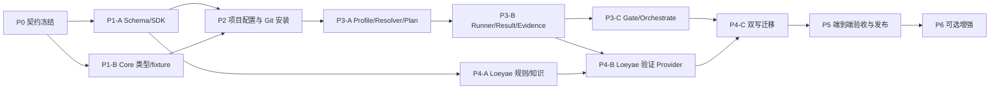

# 项目级 Git Provider 可执行任务清单

- **依据**：`aidlc-project-git-provider-optimization-design.md`、`loeyae-aidlc-provider/docs/implementation-plan.md`
- **目标**：在不削弱 AI-DLC 控制面、受控 Evidence、用户审批与人工 merge 边界的前提下，实现项目级 Git Provider 的安装、锁定、解析、执行、门禁和首个 Loeyae Boot Provider 迁移。
- **执行原则**：Provider 项目化安装、commit 锁定、安装不执行、Provider 只写 Result、Core/Runner 唯一签发 Evidence/Gate、默认 fail-closed。
- **完成状态（4.14.0）**：P0–P5 已以真实领域抽离交付；Loeyae Boot 通过独立 Provider 的 `code-generation` Hook 注入，Core 中不保留 `loeyae-compliance`、`framework-compliance`、`is_loeyae_boot` 或 compatibility 层。文中双写迁移步骤仅保留为历史任务记录。

## 1. 阶段总览与关键路径



**关键路径**：P0 → P1 → P2 → P3-A → P3-B → P3-C → P4-C → P5。  
P4-A 可与 P2/P3-A 并行，但 P4-B 必须等待 Provider SDK 与 Runner Result/Evidence 契约完成。

| 阶段 | 目标 | 主要仓库 | 阶段出口 |
|---|---|---|---|
| P0 | 冻结跨仓协议、责任和兼容策略。 | 两仓 | Schema/状态机/安全边界可评审。 |
| P1 | 建立 Provider SDK、Schema、fixture 与 Core 类型。 | `loeyae-aidlc-provider` + `loeyae-aidlc-v2` | Provider 可被静态校验，Core 可读取协议对象。 |
| P2 | 实现项目级配置、Git URL 安装、commit lock 与生命周期。 | `loeyae-aidlc-v2` | 可安全 add/list/update/disable/remove，安装不执行。 |
| P3 | 实现 Resolver、Plan、Runner、Evidence、Gate 与 directive 集成。 | `loeyae-aidlc-v2` | Provider 可从项目 lock 进入受控工作流门禁。 |
| P4 | 实现并迁移首个 Loeyae Boot Provider。 | 两仓 | 专有合规逻辑双写后由 Provider 接管。 |
| P5 | 端到端、迁移、发布和文档验收。 | 两仓 | 首个稳定项目级 Provider 可发布。 |
| P6 | 远程 Runner、供应链策略和多技术栈扩展。 | 两仓/后续仓库 | 非首发增强，不阻塞 P5。 |

## 2. P0：协议与治理冻结

MARS-150 的冻结候选统一落在以下入口；P0 评审通过后，后续任务只能按版本演进，不得在 `v1.1` 下改写语义：

- 规范：`core/knowledge/protocols/project-git-provider-core-contract.md`；
- Core wire 类型与 policy：`core/tools/aidlc-provider-types.ts`；
- 跨仓 Schema ownership：`core/tools/data/provider-schema-ownership.json`；
- 不变量回归：`tests/test_provider_core_contract.ts`。

### P0-01：冻结跨仓职责与 API 所有权

| 属性 | 内容 |
|---|---|
| 所属 | 联合设计评审（Core + Provider） |
| 前置依赖 | 无 |
| 交付物 | 1) 责任矩阵；2) API/schema 所有权表；3) `loeyae-aidlc-v2` 与 `loeyae-aidlc-provider` 的版本兼容矩阵。 |
| 必须决策 | Core 是否内置 Runner；Provider SDK 的发布方式；受保护 gate 的信任级别；开发环境的 untrusted Provider 策略。 |
| 验收 | 明确 Core 仅拥有 state/audit/report/Evidence/Gate；Provider 仅输出 Result；不存在双方重复定义同一 Schema 的情况。 |
| 阻断 | 任何一方仍可让 Provider 写控制面或自行宣布 gate 通过。 |

### P0-02：冻结规范对象与 Schema 目录

| 属性 | 内容 |
|---|---|
| 所属 | Provider 项目主责，Core 联审 |
| 前置依赖 | P0-01 |
| 交付物 | JSON Schema 目录、Schema URI、版本策略与摘要规则，至少覆盖：`provider`、`request`、`result`、`evidence`、`conformance`、`knowledge-receipt`、`project-providers`、`project-providers-lock`、`provider-plan`、`gate-decision`、`profile`。 |
| 验收 | Schema 明确 required/optional、enum、未知字段策略、扩展命名空间、路径/时间/digest 规则；可以离线验证 fixture。 |
| 阻断 | 仅有示例 JSON，没有可机读 schema。 |

### P0-03：冻结状态机、失败、fallback 与 waiver 策略

| 属性 | 内容 |
|---|---|
| 所属 | Core 主责，Provider 联审 |
| 前置依赖 | P0-01 |
| 交付物 | Plan node、Invocation Result、Rule check、Evidence、GateDecision 五层状态转换表；P0 诊断码表；fallback/waiver 审批策略。 |
| 验收 | `failed`、`error`、`deferred`、`not_applicable`、`passed_with_waiver` 的所有权和转换完全无歧义；默认 fail-closed。 |
| 阻断 | Provider 级 `not_applicable` 与 selector 语义混淆，或 `deferred` 可无时限放行。 |

### P0-04：冻结 Git 来源与受控执行安全基线

| 属性 | 内容 |
|---|---|
| 所属 | Core 主责，Provider/安全评审参与 |
| 前置依赖 | P0-01 |
| 交付物 | Git Source Policy、锁定规则、`restricted-v1` Runner 约束、签名/撤销策略、安装期安全规则。 |
| 验收 | 明确 ref→commit OID、detached checkout、禁用 hook/submodule/LFS、安装不执行、只读输入、临时输出、默认无网络、结构化 argv。 |
| 阻断 | 存在“安装时运行脚本”“按 branch HEAD 执行”或 Provider 可写 `.aidlc/evidence/` 的路径。 |

## 3. P1：协议、SDK 与测试基础

### P1-01：初始化 `loeyae-aidlc-provider` 可构建工程

| 属性 | 内容 |
|---|---|
| 所属 | `loeyae-aidlc-provider` |
| 前置依赖 | P0-01、P0-02 |
| 交付物 | Node/TypeScript 工程、精确依赖锁文件、构建/类型检查/测试命令、目录 `schemas/`、`sdk/`、`tests/`、`providers/`。 |
| 验收 | 空目录规划替换为可构建项目；依赖版本精确固定；CI/本地最小命令可运行。 |
| 阻断 | 只创建 package 配置但无 build/typecheck/test 或引入浮动/可疑依赖。 |

### P1-02：实现 Provider Schema 与 Schema 校验器

| 属性 | 内容 |
|---|---|
| 所属 | `loeyae-aidlc-provider` |
| 前置依赖 | P0-02、P1-01 |
| 交付物 | P0-02 全部 Provider 侧 Schema、Schema registry、canonical JSON/digest 工具、合法/非法 fixture。 |
| 验收 | 未知字段、错误版本、非法路径、非法状态、缺失 required、无效 digest/时间均被拒绝。 |
| 并行 | 可与 P1-03、P1-04 并行。 |

### P1-03：实现 Provider 作者 SDK

| 属性 | 内容 |
|---|---|
| 所属 | `loeyae-aidlc-provider` |
| 前置依赖 | P0-02、P1-01 |
| 交付物 | `readRequest`、Result builder、Rule Catalog helper、路径/摘要/诊断工具、知识 receipt helper。 |
| 验收 | SDK 只能构造 Provider Result；不包含 Evidence Envelope、GateDecision、state/audit 写入 API。 |
| 并行 | 可与 P1-02 并行，合并前必须对齐 Schema。 |

### P1-04：实现 Provider Conformance Fixture 基线

| 属性 | 内容 |
|---|---|
| 所属 | `loeyae-aidlc-provider` |
| 前置依赖 | P0-02、P0-03、P0-04、P1-01 |
| 交付物 | Schema、Result、权限、路径、非零退出、规则失败、签名/摘要、状态转换的正负 fixture；Conformance Report schema。 |
| 验收 | P0 负例有自动测试：手写/伪造 Evidence、路径逃逸、未声明网络、规则失败伪装成功、缺输入、错误 Plan/revision。 |

### P1-05：Core 协议类型与共享 fixture 接入

| 属性 | 内容 |
|---|---|
| 所属 | `loeyae-aidlc-v2` |
| 前置依赖 | P0-02、P1-02 |
| 交付物 | `aidlc-provider-types.ts`、Schema reader、Provider 项目 fixture 消费测试。 |
| 验收 | Core 能验证 Provider Manifest/Request/Result/Evidence 的主版本、必填字段和扩展策略；两仓 fixture 兼容。 |

## 4. P2：项目 Provider 配置与 Git 生命周期

### P2-01：实现项目配置与锁文件读写

| 属性 | 内容 |
|---|---|
| 所属 | `loeyae-aidlc-v2` |
| 前置依赖 | P0-02、P0-04、P1-05 |
| 交付物 | `aidlc-project-provider.ts`、`.aidlc/providers.yaml` 与 `.aidlc/providers.lock.yaml` parser/validator/atomic writer。 |
| 验收 | instance ID 唯一；bindings、config、subdir、ref、commit/tree/Manifest/ruleset/config digest 被校验；配置/lock 不一致 fail-closed。 |

### P2-02：实现受限 Git Source Adapter

| 属性 | 内容 |
|---|---|
| 所属 | `loeyae-aidlc-v2` |
| 前置依赖 | P0-04、P2-01 |
| 交付物 | `aidlc-provider-git.ts`、Git Source Policy、detached cache、commit/tree/Manifest digest 解析。 |
| 验收 | 使用本地 bare Git fixture 验证 HTTPS/SSH policy、tag/branch→commit、subdir、cache 恢复；hook/submodule/LFS/脚本均不执行。 |
| 阻断 | 任何测试依赖真实外网仓库或执行 Provider 代码。 |

### P2-03：实现 `provider add/list/status` CLI

| 属性 | 内容 |
|---|---|
| 所属 | `loeyae-aidlc-v2` |
| 前置依赖 | P2-01、P2-02 |
| 交付物 | `aidlc-provider-cli.ts`、`bin/cli.ts` 命令分发、帮助文档与安装审计。 |
| 验收 | `add <git-url> [--ref] [--subdir] [--id] [--instance]` 仅写项目配置/lock/cache；`list/status` 显示实例、commit、trust、binding 和锁一致性。 |

### P2-04：实现 `provider update/enable/disable/remove`

| 属性 | 内容 |
|---|---|
| 所属 | `loeyae-aidlc-v2` |
| 前置依赖 | P2-03 |
| 交付物 | 显式生命周期命令、lock history、审计事件、失效通知。 |
| 验收 | update 必须指定 ref/commit；不自动跟踪远端 branch；disable/remove 后必需 capability 缺失时 Resolver 阻断；历史 Evidence 不删除。 |

## 5. P3：Resolver、Runner、Evidence 与 Gate

### P3-01：实现 Effective Profile、bindings 与 selector

| 属性 | 内容 |
|---|---|
| 所属 | `loeyae-aidlc-v2` |
| 前置依赖 | P0-02、P0-03、P2-01 |
| 交付物 | Profile 合并、三值 selector、模块/单元 binding 匹配、Risk Fact digest。 |
| 验收 | `true/false/unknown` 行为符合规范；未知必需 selector 阻断；模块/单元仅引用项目实例，不创建新安装。 |

### P3-02：实现 Provider Resolver 与冻结 ProviderPlan

| 属性 | 内容 |
|---|---|
| 所属 | `loeyae-aidlc-v2` |
| 前置依赖 | P2-04、P3-01、P1-05 |
| 交付物 | `aidlc-provider-resolver.ts`、capability expression、依赖 DAG、冲突/fallback 决策、Plan digest/审批。 |
| 验收 | 相同输入产生相同 Plan；`all_of/any_of/at_least/exactly_one`、循环依赖、排他冲突、版本不兼容、lock 漂移均有确定结果。 |

### P3-03：扩展 directive 与 `orchestrate next`

| 属性 | 内容 |
|---|---|
| 所属 | `loeyae-aidlc-v2` |
| 前置依赖 | P3-02 |
| 交付物 | `provider_context`、`provider_actions`、Plan approval 提示、handoff 文案。 |
| 验收 | directive 指向 `provider_instance_id + lock digest + plan node`；agent 无法从全局/未锁定路径替代实例。 |

### P3-04：实现本地受控 Runner 与 ProviderRequest

| 属性 | 内容 |
|---|---|
| 所属 | `loeyae-aidlc-v2` |
| 前置依赖 | P0-04、P1-03、P2-02、P3-02 |
| 交付物 | `aidlc-provider-runner.ts`、临时目录、Request、结构化 argv、timeout/cancel、`restricted-v1` probe。 |
| 验收 | Provider 仅可读取 Request 授权输入、只写临时结果；路径逃逸、shell、未授权环境/网络、非零退出、超时/取消都不能通过。 |

### P3-05：实现 Result 验证与 Evidence Envelope

| 属性 | 内容 |
|---|---|
| 所属 | `loeyae-aidlc-v2` |
| 前置依赖 | P1-02、P1-04、P3-04 |
| 交付物 | `aidlc-provider-evidence.ts`、Result 校验、摘要/有效性键、签名/存储适配、失效传播。 |
| 验收 | Provider 不能自行生成 accepted Evidence；错误 Result/Plan/revision/lock、过期/撤销/篡改 Evidence 被拒绝；summary 由 Runner 重算。 |

### P3-06：实现 GateDecision 与 `orchestrate report` 绑定

| 属性 | 内容 |
|---|---|
| 所属 | `loeyae-aidlc-v2` |
| 前置依赖 | P0-03、P3-03、P3-05 |
| 交付物 | `aidlc-provider-gate.ts`、GateDecision、waiver/fallback/deferred 策略、`report --gate-decision`。 |
| 验收 | Gate 只消费 accepted/有效 Evidence；能力合并遵循 Plan 表达式；`report` 校验 stage/scope/Plan digest/签名；Provider 不能直接 report。 |

## 6. P4：首个 Loeyae Boot Provider 与双写迁移

### P4-01：编制 Loeyae Boot Rule Catalog 与知识映射

| 属性 | 内容 |
|---|---|
| 所属 | `loeyae-aidlc-provider` |
| 前置依赖 | P1-02、P1-03 |
| 交付物 | `providers/loeyae-boot/rules/catalog.json`、Skill→代码类型/章节映射、Rule ID/严重度/适用条件/修复说明。 |
| 验收 | 现有 Entity、Service/Repository、Controller、DTO/VO、Convert、异常、测试规则均有稳定 Rule ID；不存在仅以文字清单表达的强制规则。 |

### P4-02：实现 Loeyae Boot knowledge Provider

| 属性 | 内容 |
|---|---|
| 所属 | `loeyae-aidlc-provider` |
| 前置依赖 | P1-03、P4-01 |
| 交付物 | 渐进加载 API、Knowledge Receipt、锁定版本/章节摘要。 |
| 验收 | 可以按 Request topic 获取对应知识；receipt 绑定 Provider commit/规则集；知识加载不单独形成 Gate 通过结论。 |

### P4-03：实现 Loeyae Boot validation Provider

| 属性 | 内容 |
|---|---|
| 所属 | `loeyae-aidlc-provider` |
| 前置依赖 | P1-04、P3-04、P3-05、P4-01 |
| 交付物 | `provider.yaml`、入口、Rule checker、Provider Result、可读报告、SBOM/lockfile、Provider conformance。 |
| 验收 | 项目可通过 Git URL + subdir 安装；检查输出文件/行/Rule ID；规则失败为 `failed`，不能以文本/复选框计数伪装通过。 |

### P4-04：实现 Core compatibility adapter 与双写对账

| 属性 | 内容 |
|---|---|
| 所属 | `loeyae-aidlc-v2` |
| 前置依赖 | P3-06、P4-02、P4-03 |
| 交付物 | 原 `loeyae-compliance` 到项目 Provider 的适配层、旧/新结果对账报告、feature flag、回滚策略。 |
| 验收 | 在 Loeyae Boot fixture 上，旧 sensor 与新 Provider 输出可比较；任何差异都有 Rule/路径级诊断；非 Loeyae Profile 不受影响。 |

### P4-05：修复 scope 覆盖策略

| 属性 | 内容 |
|---|---|
| 所属 | `loeyae-aidlc-v2` + `loeyae-aidlc-provider` |
| 前置依赖 | P3-02、P4-03 |
| 交付物 | “Profile 决定 Provider 适用、scope 决定规则深度”的策略和 fixture。 |
| 验收 | Loeyae Boot 的 bugfix/refactor/express/workshop 代码变更不会整体跳过 Provider；只按变更类型裁剪规则集。 |

## 7. P5：端到端验收、迁移与发布

### P5-01：端到端项目 fixture

| 属性 | 内容 |
|---|---|
| 所属 | 两仓联合 |
| 前置依赖 | P4-04、P4-05 |
| 交付物 | Java/Loeyae Boot、多模块、非 Loeyae、轻量 scope、变更请求 fixture；本地 bare Git Provider 源。 |
| 验收 | 完整执行 add → lock → resolve → directive → run → Result → Evidence → Gate → report；无真实网络依赖。 |

### P5-02：安全与迁移回归

| 属性 | 内容 |
|---|---|
| 所属 | 两仓联合 |
| 前置依赖 | P5-01 |
| 交付物 | Git 安装期、Runner 权限、伪造 Evidence、锁漂移、更新/禁用/移除、旧 Evidence/双写回滚回归套件。 |
| 验收 | 所有 P0 安全负例 fail-closed；旧 workflow 不被破坏；迁移可回滚且保留历史 Evidence/audit。 |

### P5-03：文档、CLI 帮助与发布说明

| 属性 | 内容 |
|---|---|
| 所属 | 两仓联合 |
| 前置依赖 | P5-02 |
| 交付物 | AI-DLC CLI Guide、Provider 作者指南、业务项目安装指南、升级/回滚指南、变更日志、兼容矩阵。 |
| 验收 | 用户可从 Git URL 完成安装并理解 lock/更新行为；文档明确 Provider 与受限 Extension 的不同权限。 |

### P5-04：发布门禁

| 属性 | 内容 |
|---|---|
| 所属 | 发布负责人 |
| 前置依赖 | P5-03 |
| 交付物 | 发布清单、Conformance Report、版本 tag、Provider commit/Schema 兼容声明。 |
| 验收 | 仅当 P0/P1/P2/P3/P4/P5 任务全部通过、首个 Provider Conformance 为 passed、Core 回归通过后发布。 |

## 8. P6：非首发增强（不阻塞 P5）

| ID | 任务 | 依赖 | 交付物 | 验收 |
|---|---|---|---|---|
| P6-01 | Remote Controlled Runner | P3-04、P3-05 | mTLS adapter、远端 sandbox attestation。 | 远端 Provider 没有 Core token；本地 Runner 最终签发 Evidence。 |
| P6-02 | Git 签名/撤销/SBOM 漏洞策略 | P2-02、P5-04 | trust policy、撤销清单、许可证/漏洞 gate。 | 已撤销 commit/Provider 自动阻断并使关联 Evidence stale。 |
| P6-03 | 多技术栈 Provider 样例 | P5-04 | Spring、React、SCA/SAST、IaC Provider。 | 同一项目多 Provider 组合、冲突与排他能力均可验证。 |
| P6-04 | Provider Registry 索引 | P2-03 | 可搜索的推荐 Provider catalog。 | Registry 仅辅助发现；执行仍以项目 Git lock 为权威。 |
| P6-05 | Provider 性能与缓存 | P5-01 | cache/并行/资源基准。 | 大仓库/多 Provider 下满足既定 timeout/资源预算。 |

## 9. 依赖关系汇总

| 任务 | 直接依赖 |
|---|---|
| P1-01 | P0-01、P0-02 |
| P1-02 / P1-03 | P0-02、P1-01 |
| P1-04 | P0-02、P0-03、P0-04、P1-01 |
| P1-05 | P0-02、P1-02 |
| P2-01 | P0-02、P0-04、P1-05 |
| P2-02 | P0-04、P2-01 |
| P2-03 | P2-01、P2-02 |
| P2-04 | P2-03 |
| P3-01 | P0-02、P0-03、P2-01 |
| P3-02 | P2-04、P3-01、P1-05 |
| P3-03 | P3-02 |
| P3-04 | P0-04、P1-03、P2-02、P3-02 |
| P3-05 | P1-02、P1-04、P3-04 |
| P3-06 | P0-03、P3-03、P3-05 |
| P4-01 | P1-02、P1-03 |
| P4-02 | P1-03、P4-01 |
| P4-03 | P1-04、P3-04、P3-05、P4-01 |
| P4-04 | P3-06、P4-02、P4-03 |
| P4-05 | P3-02、P4-03 |
| P5-01 | P4-04、P4-05 |
| P5-02 | P5-01 |
| P5-03 | P5-02 |
| P5-04 | P5-03 |

## 10. 建议首批执行顺序

1. P0-01 ～ P0-04：一次设计评审中冻结；
2. 并行启动 P1-01/P1-05，以及 P1-02/P1-03/P1-04；
3. 以 P2-01 → P2-04 完成可复现的项目 Git Provider 安装闭环；
4. 执行 P3-01 ～ P3-06，先确保 Core 能安全调用任意已安装 Provider；
5. P4-01/P4-02 可提前准备，P4-03 必须等 P3-04/P3-05；
6. 完成 P4-04/P4-05 后执行 P5 端到端迁移与发布；
7. P6 仅在首个 Provider 稳定后排期，不反向扩大 P5 范围。

## 11. 完成判定

本任务清单全部完成的标志不是“Provider 仓库已创建”，而是以下链路有真实测试证据：

```text
Git URL add
→ 项目 providers.yaml/lock
→ commit 锁定
→ Profile/Binding 解析
→ Approved ProviderPlan
→ Controlled Runner Request
→ Provider Result
→ Runner Evidence Envelope
→ Core GateDecision
→ conductor report
```

并且：Provider 无法写控制面或最终 Evidence；安装不执行代码；更新不跟随 branch 漂移；Loeyae Boot 已作为首个项目级 Provider 在多 scope 下通过双写迁移验证；既有受限 Extension 权限没有被提升。
