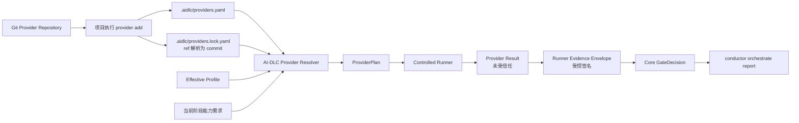
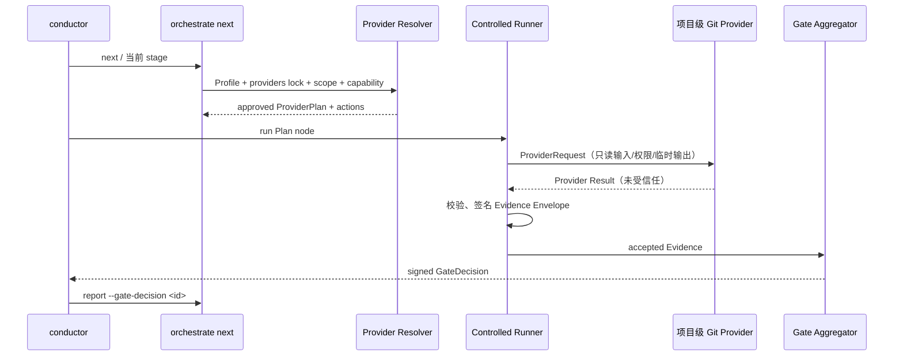

# AI-DLC 项目级 Git Provider 优化调整设计

- **状态**：拟实施设计
- **适用版本**：`loeyae-aidlc-v2` 4.13.3 之后的下一主线版本
- **关联项目**：`E:\Work\src\loeyae\loeyae-framework\loeyae-aidlc-v2`、`E:\Work\src\loeyae\loeyae-framework\loeyae-aidlc-provider`
- **目标**：将框架/技术栈/工具链专属规则从 AI-DLC Core 拆分为可由 Git 地址安装的**项目级 Provider**，同时保留 Core 对工作流、审批、Evidence 和门禁的唯一控制权。
- **P0 规范基线**：`core/knowledge/protocols/project-git-provider-core-contract.md`；摘要与该文件冲突时以后者及 `core/tools/aidlc-provider-types.ts` 为准。

## 1. 结论与决策

Provider 不应是模块级、单元级或机器全局安装物，也不应直接连接/回调 AI-DLC 控制面。目标模型为：



**项目级**是来源、版本、配置、信任和锁文件的归属；模块/单元只是 Provider 被调用时的 scope。每个项目可以安装多个 Provider，每个 Provider 可以服务多个模块和阶段，但任何模块/单元都不会自行安装、升级或替换 Provider。

首期建立独立仓库 `loeyae-aidlc-provider`，作为通用 Provider 协议、SDK/Runner Adapter、Schema 与首个 `loeyae-boot` Provider 的实施载体。后续任何团队均可按同一协议创建独立 Git Provider 仓库。

## 2. 现状与问题

### 2.1 当前 Core 的有效能力

4.13.3 已具备应保留的流程治理能力：

- `aidlc/active/aidlc-state.md` 与 `aidlc/active/audit.md` 是唯一工作流控制面；
- `orchestrate next/report` 按 project/module/unit 阶段图、`requires`、condition、产物和 sensor 推进；
- controlled Evidence 绑定 source revision、worktree digest、producer/checker，不能由 Agent 手写替代；
- code review、build/test、结构不变量、追溯矩阵等门禁可 fail-closed；
- split layout 下 module conductor 可以自主推进，但不能代用户审批或 merge/push。

这些能力必须保留在 `loeyae-aidlc-v2`，不下放到 Provider。

### 2.2 当前 Provider/Extension 相关实现的边界

| 现有项 | 现状 | 为什么不能直接扩展成新 Provider |
|---|---|---|
| `core/tools/aidlc-extension.ts` | 受限 Extension 只复制 Markdown 产物，并生成非权威 projection。 | 显式禁止 `runtime_command`、`tool`、`command`、`script`、`approval`、`requires`、`condition`；不能激活 canonical stage graph 或生成 controlled Evidence。 |
| `aidlc-diagram-provider.ts` | 内置 Chrome DevTools 专用请求适配器。 | 是单一工具的专用实现，不包含项目安装、Git 锁定、通用 Plan/Request/Result/Evidence 协议。 |
| `loeyae-compliance` 阶段 | 在 `is_loeyae_boot` 条件下执行，产出 `framework-compliance.json`。 | 仅覆盖 Loeyae Boot，且 `framework-compliance` 当前只验证 `skills_loaded/checks_total/checks_failed` 的汇总字段，无法作为多技术栈通用协议。 |
| MCP Skills | 提供规范知识和渐进式章节加载。 | 可成为 knowledge Provider 的内容来源，但知识加载本身不能替代源码、测试、审查和构建的受控验证。 |

### 2.3 需要解决的缺口

1. 当前没有项目级 Provider 清单、来源锁定或 Git URL 安装命令；
2. 技术栈判断主要依赖 Core 条件和特定阶段，无法平等支持 Spring、React、Python、Go、云平台等；
3. Provider 没有统一的调用边界，外部脚本若直接接入会绕过 Core 的 state/audit/Evidence 约束；
4. Git URL 若只保存 branch/tag，无法保证可复现，且安装期可能误执行不可信代码；
5. 当前 Loeyae 合规阶段的 scope 与文档“不可跳过”的口径不一致：阶段仅在 `feature/enterprise/mvp/classic` 路由，`bugfix/refactor/express/workshop` 不一定触发。

## 3. 目标、非目标与不变量

### 3.1 目标

- 用户可在 AI-DLC 项目根执行 `provider add <git-url>` 安装 Provider；
- Git 地址可以是 HTTPS、SSH 或项目策略允许的私有源；`ref` 可为 tag/branch/commit，但运行必须锁定到不可变 commit OID；
- Provider 在项目内只安装一次，由 `.aidlc/providers.yaml` 和 `.aidlc/providers.lock.yaml` 管理；
- Provider 可按 binding 服务不同模块、单元和阶段；
- Provider 通过标准 Request/Result 协议提供知识或验证服务；
- Core/Runner 将 Result 校验、封装为 Evidence，Core 再生成 GateDecision；
- 首个可迁移能力是 `loeyae-compliance`，但协议不绑定 Loeyae Boot。

### 3.2 非目标

- 不将 Provider 变为可直接修改 `aidlc-state.md`、`audit.md` 或 stage graph 的插件；
- 不允许 Provider 自动 approve、merge、push、发起未受控子代理或直接调用 `orchestrate report`；
- 不在安装 Git 仓库时执行 Provider entrypoint、构建脚本、Git hook、submodule 或 LFS filter；
- 不引入“所有项目都必须联网下载 Provider”的隐式行为；缺少 Provider 时由 directive 显式提示安装/确认；
- 不将现有受限 Extension 提升权限；Extension 与 Provider 保持不同安全等级和用途。

### 3.3 不变量

```text
控制面所有权：仅 Core/conductor 可写 state/audit/report
证据所有权：仅 Controlled Runner 可生成 accepted Evidence Envelope
运行来源：仅 lock 中的 commit OID 可执行
版本来源：仅 providers.lock.yaml 是项目级运行事实
安装行为：Git 获取与 Manifest 校验不执行 Provider 代码
失败行为：缺来源、锁不一致、签名/兼容性/证据不合法默认阻断
```

## 4. 目标架构

### 4.1 分层

| 层 | 位置 | 职责 |
|---|---|---|
| AI-DLC Core | `loeyae-aidlc-v2` | CLI、Profile、项目 Provider 配置/锁、Resolver、阶段 directive、Runner 调度、Evidence/Gate、audit。 |
| Provider Protocol/SDK | `loeyae-aidlc-provider` | Manifest/Request/Result Schema、SDK、Runner Adapter、conformance fixture、Provider 作者工具。 |
| Domain Provider | `loeyae-aidlc-provider` 首期的 `providers/loeyae-boot` 或未来独立 Git 仓库 | 领域规则、知识、检查器、报告和 Provider entrypoint。 |
| Project Configuration | 被 AI-DLC 管理的业务项目 `.aidlc/` | 已安装 Provider 实例、锁定 commit、项目配置、绑定、Evidence 与审计。 |

### 4.2 项目级 Provider Instance

```text
Provider Repository
  └─ provider.yaml + rules + entrypoint + lock + SBOM
       ↓ provider add <git-url>
Project Provider Instance
  ├─ instance_id            项目内稳定身份
  ├─ git/ref/subdir         用户意图
  ├─ commit/tree/manifest   锁定事实
  ├─ config                 项目级 Provider 配置
  └─ bindings               可服务的模块/阶段/capability
       ↓ Resolver
ProviderPlan Node
  └─ instance_id + lock digest + scope + invocation
```

Provider Repository 可以是独立仓库，也可以是 monorepo 的 `subdir`。Provider Instance 可有多个，但每个 `instance_id` 必须唯一；同一 Provider ID 如需不同配置，必须安装为不同实例。

### 4.3 项目文件

`.aidlc/providers.yaml` 表达项目意图，允许提交到项目 Git：

```yaml
apiVersion: aidlc.project-providers/v1
specVersion: 1.0.0
providers:
  - instance_id: loeyae-boot
    id: framework.java-loeyae-boot
    source:
      git: https://github.com/loeyae/loeyae-aidlc-provider.git
      ref: v0.1.0
      subdir: providers/loeyae-boot
    enabled: true
    config:
      skills_mode: progressive
    bindings:
      - modules: ["*"]
        stages: [code-generation, code-review, build-and-test]
        capabilities:
          - aidlc.framework-conventions.java
          - loeyae.framework-conventions.boot
          - loeyae.test-conventions
    trust:
      mode: signed-commit-or-tag
      required_for_protected_gates: true
```

`.aidlc/providers.lock.yaml` 由 Core 写入并作为执行锚点：

```yaml
apiVersion: aidlc.project-providers-lock/v1
specVersion: 1.0.0
providers:
  - instance_id: loeyae-boot
    id: framework.java-loeyae-boot
    source:
      git: https://github.com/loeyae/loeyae-aidlc-provider.git
      requested_ref: v0.1.0
      commit_oid: "<immutable-git-oid>"
      object_format: sha1
      tree_oid: "<tree-oid>"
      subdir: providers/loeyae-boot
    manifest:
      version: 0.1.0
      digest: sha256:<provider-yaml>
      ruleset:
        id: loeyae-boot-baseline
        version: 0.1.0
        digest: sha256:<catalog>
    artifacts:
      provider_lock_digest: sha256:<provider-lock>
      sbom_digest: sha256:<sbom>
      entrypoint_digest: sha256:<entrypoint>
    project_config_digest: sha256:<config>
```

`ref` 仅用于首次定位；执行、Plan 和 Evidence 只能使用 `commit_oid`、`tree_oid`、Manifest digest 和 config digest。

## 5. Git 安装与生命周期

### 5.1 CLI

```bash
# 新增项目级 Provider；不执行 Provider 代码
loeyae-aidlc provider add <git-url> [--ref <tag|branch|commit>] \
  [--subdir <relative-path>] [--id <provider-id>] [--instance <instance-id>]

# 查看当前项目实例和锁定信息
loeyae-aidlc provider list --project
loeyae-aidlc provider status <instance-id>

# 显式更新；不会自动跟随远端 branch/tag
loeyae-aidlc provider update <instance-id> --ref <tag|branch|commit>

# 生命周期治理
loeyae-aidlc provider disable <instance-id>
loeyae-aidlc provider enable <instance-id>
loeyae-aidlc provider remove <instance-id>
```

### 5.2 `provider add` 处理步骤

1. 校验 Git URL、协议、host/组织 allowlist、项目路径及用户认证；
2. 以 `core.hooksPath` 禁用、`submodule.recurse=false`、LFS filter 禁用的受限方式获取引用；
3. 将 tag/branch/default HEAD 解析为 commit OID，使用 detached checkout；
4. 仅读取指定 `subdir/provider.yaml`、规则集、lockfile、SBOM，校验 Schema 与兼容性；
5. 不执行仓库脚本、Provider entrypoint、构建工具或 package manager；
6. 以 instance ID 写 `providers.yaml`，以 commit/tree/digest 写 lock；
7. 使引用旧 lock 的 ProviderPlan/Evidence 变为 stale；
8. 返回安装结果、信任状态、需要批准的风险和下一步 directive。

### 5.3 更新、禁用与移除

- `update` 必须显式指定 ref/commit，生成新的 lock entry；旧 Evidence/Gate 因 lock digest 变化而失效；高风险 Plan 需要重新审批；
- `disable` 保留配置、lock、cache 和历史 Evidence，但不参与新 Plan；
- `remove` 从意图配置移除实例，旧 lock 转历史记录；若它是必需 capability 的唯一来源，Resolver 必须阻断；
- 任何操作写入 audit，不得删除历史 Evidence 或修改既有 GateDecision。

## 6. Provider 调用、Evidence 与主流程集成

### 6.1 Directive 扩展

`orchestrate next` 为当前阶段输出项目级 Provider actions：

```yaml
provider_context:
  project_provider_lock: .aidlc/providers.lock.yaml
  lock_digest: sha256:<digest>
  plan:
    id: plan-018f3dca
    digest: sha256:<digest>
    status: approved
  actions:
    - id: load-loeyae-guidance
      provider_instance_id: loeyae-boot
      type: knowledge
      topic: controller-and-service
      required_before: implementation
    - id: validate-loeyae-implementation
      provider_instance_id: loeyae-boot
      type: validation
      node: loeyae-boot/order-service/create-order/implementation-validation
      required_after: implementation
      gate: implementation-validation
```

Agent/conductor 只能运行 directive 中列出的 `provider_instance_id`；不得从全局缓存、未锁定 Git branch 或另一个同名仓库替换该实例。

### 6.2 Runner 调用链



Provider 只写 Provider Result 和声明的报告到 Invocation 临时目录；Runner 校验并写入 `.aidlc/evidence/providers/...`；Core 以有效 Evidence 生成 GateDecision；只有 conductor 能依据 GateDecision 执行 `orchestrate report`。

### 6.3 Provider Request 与 Result

Request 至少绑定项目实例和 lock：

```json
{
  "schema": "aidlc.provider-request/v1.1",
  "invocation_id": "inv-018f3dca",
  "plan_digest": "sha256:<digest>",
  "provider_instance": {
    "instance_id": "loeyae-boot",
    "provider_id": "framework.java-loeyae-boot",
    "project_lock_digest": "sha256:<digest>",
    "commit_oid": "<oid>",
    "manifest_digest": "sha256:<digest>",
    "config_digest": "sha256:<digest>"
  },
  "scope": {"module_id": "order-service", "unit_id": "create-order"}
}
```

Result 是未受信任载荷；它不得包含/覆盖 source revision、Plan digest、Runner identity、最终 Evidence、审批或签名。Runner 必须验证 Result 与 Request/Plan/lock 一致，重新计算汇总，随后创建签名 Evidence Envelope。

### 6.4 与现有阶段的映射

| 现有阶段/能力 | 目标 Provider 集成 |
|---|---|
| `workspace-detection` | 检查 `providers.yaml`/lock；识别 Profile 缺失、锁不一致或未安装的必需能力。 |
| `application-design` | 固定该模块后续需要的 capability expression，随应用设计审批进入 Plan digest。 |
| `units-generation` / `unit select` | 将项目级 binding 解析为 module/unit Plan node；不会复制或安装 Provider。 |
| `code-generation` 前 | knowledge Provider 提供锁定版本的框架/测试/安全章节，生成 receipt，但 receipt 不单独通过门禁。 |
| `code-generation` 后 | 调用 implementation validation Provider，生成语言/框架/数据访问/测试规则 Evidence。 |
| `code-review` | 执行隔离审查 Provider 或 Core 内置 reviewer Provider，保留双轴审查。 |
| `build-and-test` | 执行受控构建测试、SAST/SCA、契约和性能等适用 Provider。 |
| `operations-*` | 执行部署/IaC/云平台/回滚 Provider；最终部署授权仍由用户 Approve。 |
| CR1—CR5 | Profile、lock、config、规则集、源代码变更均参与 Evidence 失效；CR5 只接受当前 revision 有效 Gate。 |

## 7. Provider 分类与首个迁移目标

### 7.1 通用分类

| 类型 | 职责 | 是否单独满足 Gate |
|---|---|---:|
| knowledge Provider | 受版本锁定地提供规范/示例章节，生成 receipt。 | 否。 |
| validation Provider | 读取受控输入、执行规则、返回规则级 Result。 | 是，经 Runner/Core 处理后。 |
| command Provider | 在 allowlist 中执行构建、测试、迁移等命令。 | 仅与 validation/Core Evidence 组合后。 |
| composite Provider | 按显式 DAG 组合子 Provider Evidence。 | 可以，但不能伪造子结果。 |

### 7.2 Loeyae Boot Provider

首期从 Core 迁移的目标不是整个 workflow，而是现有 `loeyae-compliance` 的**领域知识和检查实现**：

```text
Core 保留：condition/route、Plan、Runner、Evidence、Gate、用户审批、report
Provider 移出：Loeyae Skill 映射、规则 catalog、Entity/Service/Controller/DTO/Test 检查器、可读报告
```

建议 Provider ID：`framework.java-loeyae-boot`；项目实例默认名：`loeyae-boot`；Git 安装源为 `loeyae-aidlc-provider` 的 `providers/loeyae-boot` 子目录。

迁移后，Core 的原 `loeyae-compliance` 专有阶段应演进为通用的 `implementation-validation` capability 挂载点。为减少一次性风险，过渡期允许：

1. 保留原阶段和原 sensor；
2. 用项目级 Provider 生成兼容的 framework-compliance 结果；
3. 双写/只读对账；
4. 当 Provider Evidence 与新 Gate 稳定后，废弃 Core 中的 Loeyae 规则和 MCP Skill 表。

## 8. Core 改造边界

### 8.1 新增模块

建议在 `core/tools/` 新增：

| 文件 | 责任 |
|---|---|
| `aidlc-provider-types.ts` | Provider/Profile/Plan/Request/Result/Evidence/Gate 的 TypeScript 类型与 Schema 引用。 |
| `aidlc-project-provider.ts` | 读取/校验 `providers.yaml`、lock、project instance、binding 与有效配置。 |
| `aidlc-provider-git.ts` | Git URL、受限 fetch、commit/tree/digest、detached cache、add/update/disable/remove。 |
| `aidlc-provider-resolver.ts` | selector 三值逻辑、capability expression、依赖 DAG、Plan digest。 |
| `aidlc-provider-runner.ts` | Request、sandbox、entrypoint/remote adapter、Result 校验、临时目录和原子发布。 |
| `aidlc-provider-evidence.ts` | Runner 签名 Evidence Envelope、有效性键、失效传播。 |
| `aidlc-provider-gate.ts` | capability 聚合、GateDecision、waiver/fallback/deferred 裁决。 |
| `aidlc-provider-cli.ts` | `provider add/list/status/update/enable/disable/remove/resolve/run/gate` 子命令。 |

### 8.2 修改既有模块

| 文件 | 调整 |
|---|---|
| `bin/cli.ts` | 增加 `provider` 命令分发和帮助；不改变现有 `extension` 命令语义。 |
| `core/tools/aidlc-orchestrate.ts` | 生成/校验 ProviderPlan，向 directive 写 `provider_context/actions`，`report` 验证 GateDecision。 |
| `core/tools/aidlc-evidence.ts` | 保持现有 controlled producer；只通过明确桥接消费 Provider Evidence，不接受手写 JSON。 |
| `core/tools/aidlc-semantic-checks.ts` | 将 Loeyae 启发式 `frameworkCompliance()` 拆为过渡 adapter；通用 Provider Gate 成为新的证据消费者。 |
| `core/tools/aidlc-extension.ts` | 不放宽限制；文档明确 Extension 仅为 advisory Markdown 扩展，不能替代 Provider。 |
| `core/tools/data/stage-graph.json` | 增加通用 capability 挂载元数据，不能允许 Provider 自行更改 stage 的 `requires/approval/condition`。 |
| `core/stages/construction/construction-loeyae-compliance.md` | 迁移期标为 compatibility adapter；最终替换为通用 implementation validation 说明。 |

### 8.3 受控执行安全

- Provider 默认在 `restricted-v1` sandbox 执行：只读项目/cache、唯一临时输出目录、最小环境变量、非特权用户、CPU/内存/PID/磁盘限制、默认无网络；
- 命令为结构化 argv allowlist，禁止 shell；
- Git 凭据只能用于 fetch，不进入 Provider Request/Result/Evidence/log；
- remote Provider 必须经受控 Runner Adapter/mTLS，不持有 Core 控制面凭据，不允许 webhook 回调；
- Provider Bundle/commit 的签名、SBOM、lockfile、Conformance 由项目策略决定是否可用于受保护门禁；
- `providers.lock.yaml` 或 Provider config 的变化必须使相关 Evidence/Gate 失效。

## 9. 数据、版本与兼容性

### 9.1 Schema

首期须交付并固定以下 Schema：

```text
aidlc.project-providers/v1
aidlc.project-providers-lock/v1
aidlc.profile/v1.1
aidlc.provider/v1.1
aidlc.provider-plan/v1.1
aidlc.provider-request/v1.1
aidlc.provider-result/v1.1
aidlc.provider-evidence/v1.1
aidlc.gate-decision/v1.1
aidlc.provider-conformance/v1.1
```

JSON 采用 RFC 8785 JCS 规范化，摘要使用 `sha256:<hex>`，时间使用 UTC RFC 3339。未知字段默认拒绝，供应商扩展只允许 `extensions.<namespace>`。

### 9.2 状态模型

| 层 | 状态 |
|---|---|
| Plan node | `selected`、`not_selected`、`unknown`、`blocked`。 |
| Invocation Result | `passed`、`failed`、`deferred`、`error`、`cancelled`。 |
| Rule check | `passed`、`failed`、`not_applicable`；`waived` 仅是 Core Gate 对原始 `failed` 的派生 evaluation，不得由 Provider Result 自报。 |
| Evidence | `accepted`、`stale`、`expired`、`revoked`。 |
| GateDecision | `passed`、`passed_with_waiver`、`blocked`。 |

Provider 级 `not_applicable` 由 selector 决定；Provider 仅可对已调用的单项 rule 返回 `not_applicable`。默认 fail-closed；`deferred/fallback/waiver` 必须同时获得 Manifest、Core policy 和阶段 policy 许可，并含到期和补跑要求。

## 10. 实施阶段与验收

### Phase A：协议与项目配置

- 在 `loeyae-aidlc-provider` 定义 Schema、SDK 类型、Provider 仓库布局、conformance fixture；
- 在 Core 实现 `providers.yaml`/lock、Git add/list/status 和无执行安装；
- 验收：Git URL 可添加，branch/tag 被解析为 commit OID，lock 可复现，安装期间没有 Provider 代码执行。

### Phase B：Resolver、Plan 与 directive

- 实现项目级 binding、Effective Profile、selector 三值逻辑、capability expression 和 Plan digest；
- `orchestrate next` 输出 Provider context/actions；
- 验收：同输入生成相同 Plan；模块只引用项目 instance；未知 selector/冲突/锁漂移 fail-closed。

### Phase C：Runner、Evidence 与 Gate

- 实现 ProviderRequest、受限本地 Runner、Result 校验、Evidence Envelope、GateDecision 与 `report --gate-decision`；
- 验收：Provider 无法直接写 state/audit/Evidence；伪造 Result、错 revision、过期 lock、越权路径和非零退出均不能放行。

### Phase D：Loeyae Boot Provider 迁移

- 在外部 Provider 项目实现 skill mapping、规则 catalog、静态/结构化检查与可读报告；
- Core 为 `loeyae-compliance` 建 compatibility adapter，双写对账后改为 implementation-validation capability；
- 验收：Loeyae Boot 的 feature/bugfix/refactor/express 等实际代码变更按 scope 深度裁剪规则，但不会因 scope 被整体绕过；非 Loeyae 项目不加载该 Provider。

### Phase E：多 Provider 与高级场景

- 引入 Java/Spring、React、SCA/SAST、部署/IaC 示例 Provider；
- 实现远程 Runner Adapter、签名/撤销、SBOM/漏洞策略和 Provider Conformance；
- 验收：多技术栈项目可同时使用多个项目级 Provider，冲突/排他 capability 有明确决策，CR 会正确失效并重跑受影响 Provider。

## 11. 测试策略

新增测试不得通过真实网络拉取任意 Git 仓库；使用本地临时 bare Git fixture 或受控 file fixture 模拟 Git 远端。

| 测试类别 | 必须覆盖 |
|---|---|
| Project provider config | providers.yaml/lock Schema、实例唯一性、binding、config digest、锁漂移。 |
| Git source | URL policy、tag/branch→commit、detached checkout、subdir、拒绝 hook/submodule/LFS、更新不自动漂移。 |
| Resolver | Profile 继承、selector true/false/unknown、capability all_of/any_of/exclusive、依赖循环、Plan 确定性。 |
| Runner | Request 最小权限、路径逃逸、shell/环境变量/网络拒绝、超时/取消、临时输出原子发布。 |
| Evidence/Gate | 伪造 Result、错误 revision/lock、签名/摘要不匹配、stale/expired、fallback/waiver、Gate 与 report 绑定。 |
| Migration | 原 loeyae-compliance 双写、非 Loeyae 不适用、轻量 scope 的规则裁剪、旧 Evidence 不误放行。 |
| Conformance | Provider Bundle/Manifest/Result fixture、负向安全 fixture、Loeyae Boot 首个 Provider 的端到端 smoke。 |

现有 `tests/test_restricted_extension.ts` 必须继续通过，以证明 Provider 改造没有提升 Extension 的权限。现有 `test_provider_adapter.py` 与 `test_provider_config.py` 保留为 Chrome DevTools 专用兼容测试，后续可逐步迁入通用 Provider Runner fixture。

## 12. 风险与缓解

| 风险 | 缓解 |
|---|---|
| Git URL 引入供应链风险 | 安装不执行、commit 锁定、Git Source Policy、签名/tag 策略、SBOM/lockfile、protected gate 的 trust policy。 |
| Provider 破坏控制面 | Provider 永不拥有 state/audit/report 写权限；Runner/Core 签发 Evidence/Gate。 |
| Provider 规则过重影响轻量 scope | scope 只裁剪规则和所需 capability，不允许因 scope 整体跳过已识别技术栈验证。 |
| Provider 更新造成历史不可复现 | lock 保存 commit/tree/Manifest/ruleset/config digest；历史 Evidence 引用旧 lock。 |
| 一次性重写现有门禁风险高 | Phase D compatibility adapter 和双写对账；Core controlled Evidence 保持为权威。 |
| 多 Provider 规则冲突 | capability expression、exclusive group、显式 binding 与用户确认；未知/冲突 fail-closed。 |

## 13. 完成条件

本优化完成的最小标准：

1. AI-DLC 项目能以 Git URL 添加、锁定、列出、更新、禁用和移除项目级 Provider；
2. 每次运行只使用 lock 中的 commit，且安装过程不执行 Provider 代码；
3. directive、Plan、Request、Evidence、Gate 和 report 可全链路追踪 `provider_instance_id + lock digest + scope`；
4. Provider 无法绕过 Core 控制面或伪造 accepted Evidence；
5. 首个 Loeyae Boot Provider 已从专有 Core 规则中迁出，并对非 Loeyae 项目不产生影响；
6. 现有 Extension、review/build/test、用户审批和人工 merge 安全边界不被削弱；
7. 新增单元/集成/负向安全测试进入受影响包的验证路径。
